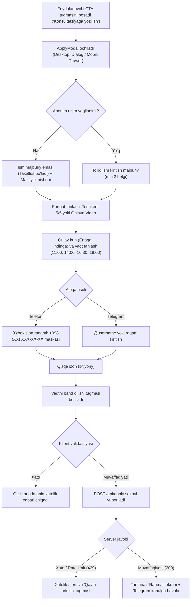

# FRONTEND & UI/UX AUDIT HUJJATI: DINNA MIRZABAYEVA LOYIHASI

> **Auditor**: Senior Frontend Auditor  
> **Loyiha**: Dinna Mirzabayeva (Psixolog va Shaxsiy Rivojlanish Treneri shaxsiy veb-sayti)  
> **Sana**: 2026-11-19  
> **Metodologiya**: Kod bazasini statik va strukturaviy tahlil qilish, komponentlar, dizayn tokenlari, responsivlik, i18n va foydalanuvchi tajribasini (UX) to'liq tekshirish.

---

## 1. LOYIHA XARITASI

### 1.1. Barcha Sahifalar (Route'lar) va Vazifalari

| Route | Fayl yo'li | Turi | Vazifasi va Tavsifi |
| :--- | :--- | :--- | :--- |
| `/` | `src/app/layout.tsx`, `not-found.tsx` | Server (Root) | Ildiz marshrut: `next-intl` middleware orqali defolt til (`/uz`) ga yo'naltiriladi yoki 404 beradi. |
| `/[locale]` | `src/app/[locale]/page.tsx` | Server Component | Asosiy landing page (Dinna Mirzabayeva taqdimoti, xizmatlar, 3 bosqichli metodologiya, muallif haqida, diplomlar, sharhlar, media, kitob, FAQ, aloqa formasi). |
| `/[locale]/bron` | `src/app/[locale]/bron/page.tsx` | Server Component | Konsultatsiya uchun vaqt tanlash sahifasi: Cal.com interaktiv kalendar emebedi orqali seans bron qilish. |
| `/[locale]/test` | `src/app/[locale]/test/page.tsx` | Server Component | 3 daqiqalik psixologik diagnostika testi (4 ta savol, anonim rejim, natija kartasi va Telegram orqali bog'lanish). |
| `/api/apply` | `src/app/api/apply/route.ts` | API (Node.js runtime) | Konsultatsiya va kitob buyurtmasi arizalarini qabul qilish: IP rate limit (3 ta/min), honeypot antispam, Zod validatsiya, Telegram Bot API ga yuborish. |
| `/api/lead` | `src/app/api/lead/route.ts` | API (Node.js runtime) | `/api/apply` marshrutining re-export nusxasi (orqaga moslik uchun). |
| `/api/quiz` | `src/app/api/quiz/route.ts` | API (Node.js runtime) | Test javoblarini qabul qilish: serverda ball va diagnostik toifani hisoblash, Telegram guruhiga yuborish, natija qaytarish. |
| `/api/cal-webhook` | `src/app/api/cal-webhook/route.ts` | API (Node.js runtime) | Cal.com vebhuklarini qabul qilish: HMAC SHA-256 xavfsizlik tekshiruvi, bron yaratilganda/o'zgartirilganda Telegramga xabar berish. |

---

### 1.2. Sahifalardagi Section / Komponentlar Tartibi (Yuqoridan Pastga)

#### A. Asosiy Landing Sahifasi (`src/app/[locale]/page.tsx`)
1. **Navbar** (`src/components/layout/Navbar.tsx`) — Fiksatsiyalangan navigatsiya paneli (monogramma, menyu havolalari, CTA tugmasi, LanguageSwitcher).
2. **Hero** (`src/components/sections/Hero.tsx`) — Asosiy birinchi ekran: H1 sarlavha, psixolog portreti, status pilli (`Toshkent 5/5 · Qabul ochiq`), 3 ta metrika (`500+`, `98%`, `5/5 ★`), uzluksiz Marquee ticker tasmasi.
3. **Services** (`src/components/sections/Services.tsx`) — Bento grid (Individual konsultatsiya, Onlayn terapiya, Mualliflik treningi), interaktiv Tabs taqqoslash va 15 daqiqalik bepul diagnostika banneri.
4. **Stages** (`src/components/sections/Stages.tsx`) — 3 bosqichli seans metodologiyasi (01 Tayyorgarlik, 02 Seans, 03 Natija) va tanlangan bosqich bo'yicha interaktiv chuqur tahlil kartasi.
5. **Expert** (`src/components/sections/Expert.tsx`) — Dinna Mirzabayeva monografiyasi, sitata, 3 ta falsafiy ustun va 3 ta professional diplom / sertifikat galereyasi (Lightbox modal bilan).
6. **MediaArchive** (`src/components/sections/MediaArchive.tsx`) — 3 ta tabdan iborat media-markaz:
   - *01 Mijozlar fikrlari* (6 ta anonim mijoz natijalari)
   - *02 Psixologik tavsiyalar* (video-darslar va YouTube modal)
   - *03 Treninglar va Sayohatlar* (hududiy treninglar kartalari)
7. **BookCtaSplit** (`src/components/sections/BookCtaSplit.tsx`) — Split-screen ekran: Chapda kitob muqovasi va buyurtma formasi, o'ngda 3 daqiqalik testga chorlovchi monolit blok.
8. **FAQ** (`src/components/sections/FAQ.tsx`) — Jonli qidiruv (Live search), 4 ta toifa bo'yicha filtr, akkordeon savol-javoblar va qo'shimcha savol berish bloki.
9. **Contact** (`src/components/sections/Contact.tsx`) — To'g'ridan-to'g'ri aloqa rekvizitlari (telefon, Telegram kanal/lichka, Instagram, 5/5 ofis) va anonim switch'li tezkor konsultatsiya formasi.
10. **Footer** (`src/components/layout/Footer.tsx`) — Mualliflik huquqlari va ijtimoiy tarmoqlar havolalari.
11. **MobileStickyBar** (`src/components/layout/MobileStickyBar.tsx`) — Mobil qurilmalarda ekranning pastida qotib turuvchi tezkor amallar paneli (Testdan o'tish + Yozilish).
12. **Global Modallar**:
    - `ApplyModal` (`src/features/apply/components/ApplyModal.tsx`) — Global kontekst (`ApplyModalContext`) orqali ochiluvchi konsultatsiya formasi.
    - `Lightbox` (`src/components/ui/Lightbox.tsx`) — Diplomlarni kattalashtirib ko'rish.
    - `YouTubeModal` (`src/components/ui/YouTubeModal.tsx`) — Videolarni ko'rish.

#### B. Bron Sahifasi (`src/app/[locale]/bron/page.tsx`)
1. **Navbar**
2. **BookingView** (`src/features/booking/components/BookingView.tsx`):
   - Kicker va H1 sarlavha ("Konsultatsiya uchun vaqtni tanlang")
   - 3 ta ustunlik nishoni (60-90 daqiqa, Toshkent 5/5 yoki Onlayn, 100% maxfiy)
   - Cal.com reaktiv oylik kalendar embed'i yoki yuklanish skeleti
   - Muvaffaqiyat xabarnomasi yoki xatolikda Telegram zaxira havolasi
3. **Footer**
4. **MobileStickyBar**

#### C. Diagnostika Sahifasi (`src/app/[locale]/test/page.tsx`)
1. **Navbar**
2. **QuizView** (`src/features/quiz/components/QuizView.tsx`):
   - 1-qadam: Intro (Diagnostika maqsadi va boshlash tugmasi)
   - 2-qadam: Savollar (4 ta ketma-ket savol, progress bar, A/B/C/D variantlar)
   - 3-qadam: Lead form (Anonimlik tugmasi, ism/taxallus, telefon/Telegram, format tanlash)
   - 4-qadam: Natija kartasi (Q1 ga asoslangan shaxsiy muammo tahlili, mos terapiya tavsiyasi, Telegramga 1-klikda o'tish)
3. **Footer**
4. **MobileStickyBar**

---

### 1.3. Paketlar va Versiyalar (`package.json`)

| Paket guruhi | Paket nomi | Loyihadagi versiya |
| :--- | :--- | :--- |
| **Asosiy freymvork** | `next` | `^15.1.7` (App Router) |
| **Kutubxona** | `react` / `react-dom` | `^19.0.0` (React 19) |
| **Til va Tiplash** | `typescript` | `^5.7.3` |
| **Styling** | `tailwindcss` | `^3.4.17` |
| | `postcss` / `autoprefixer` | `^8.5.2` / `^10.4.20` |
| | `tw-animate-css` | `^1.4.0` |
| | `tailwind-merge` | `^3.7.0` |
| | `class-variance-authority` | `^0.7.1` |
| | `clsx` | `^2.1.1` |
| **Internatsionalizatsiya** | `next-intl` | `^3.26.3` |
| **Animatsiya va Skroll** | `framer-motion` | `^14.2.0` |
| | `lenis` | `^1.3.26` |
| **UI va Primitivlar (Radix/Shadcn)** | `@radix-ui/react-accordion` | `^1.3.1` |
| | `@radix-ui/react-avatar` | `^1.3.1` |
| | `@radix-ui/react-dialog` | `^1.3.1` |
| | `@radix-ui/react-dropdown-menu` | `^2.2.1` |
| | `@radix-ui/react-label` | `^2.1.17` |
| | `@radix-ui/react-progress` | `^1.2.1` |
| | `@radix-ui/react-radio-group` | `^1.5.1` |
| | `@radix-ui/react-scroll-area` | `^1.4.0` |
| | `@radix-ui/react-select` | `^2.4.1` |
| | `@radix-ui/react-separator` | `^1.2.0` |
| | `@radix-ui/react-slot` | `^1.5.0` |
| | `@radix-ui/react-switch` | `^1.4.1` |
| | `@radix-ui/react-tabs` | `^1.2.1` |
| | `radix-ui` | `^1.8.1` |
| | `vaul` (Mobile Drawer) | `^1.1.2` |
| | `react-aria-components` | `^1.22.1` |
| **Ikonkalar** | `lucide-react` | `^1.76.0` |
| **Integratsiya** | `@calcom/embed-react` | `^1.5.3` |
| **Validatsiya** | `zod` | `^3.24.2` |
| **Testlash** | `playwright` | `^1.64.1` |

---

## 2. DESIGN TOKENS

### 2.1. Ranglar Palitrasi (Aniqlangan Qiymatlar)

Loyiha kod bazasida 2 xil rang palitrasi to'qnashuvi mavjud: yangi **Warm Sage & Cream** palitrasi va eski **Obsidian & Gold** qorong'i mavzu tokenlari.

#### Amaldagi Issiq Palitra (Warm Sage, Cream, Terracotta):
| Token nomi | Tailwind class | Hex / HSL qiymati | Ishlatilish joyi |
| :--- | :--- | :--- | :--- |
| `cream-50` | `bg-cream-50` | `#FCFBF9` | Eng yengil fon kartalari |
| `cream-100` / `cream` | `bg-cream` | `#FAF8F5` (`hsl(40 25% 97%)`) | Asosiy body va sahifalar foni |
| `cream-200` | `bg-cream-200` | `#F2EFE9` (`hsl(40 18% 93%)`) | Neytral sirtlar, inputlar, footer foni |
| `cream-300` / `border` | `border-cream-300` | `#E5E0D8` (`hsl(38 18% 87%)`) | Kartalar va bo'limlar ajratuvchi chiziqlari |
| `cream-400` | `bg-cream-400` | `#D6CFC4` | Chuqurroq chegaralar |
| `sage` (DEFAULT) | `bg-sage`, `text-sage` | `#2E5A44` (`hsl(150 32% 26%)`) | Birlamchi brend rangi, tugmalar, faol linklar |
| `sage-hover` | `hover:bg-sage-hover` | `#234735` | Birlamchi tugmalar hover holati |
| `sage-light` | `text-sage-light` | `#3D7056` | Ikkilamchi urg'ular |
| `sage-dark` | `bg-sage-dark` | `#1B3829` | Chuqur zumrad foni |
| `sage-soft` | `bg-sage-soft` | `rgba(46, 90, 68, 0.08)` | Tantanali nishonlar, fon xira ranglari |
| `sage-dim` | `bg-sage-dim` | `rgba(46, 90, 68, 0.15)` | Tanlangan variantlar foni |
| `terracotta` | `text-terracotta` | `#C59B6D` | Oltin/terrakotta urg'u, dekorativ barglar, yulduzlar |
| `terracotta-light` | - | `#D8B48D` | Yoritilgan urg'ular |
| `terracotta-hover` | - | `#B58A5B` | Hover holatlari |
| `terracotta-dark` | - | `#9E7445` | Chuqur terrakotta |
| `charcoal` | `text-charcoal` | `#1F2924` (`hsl(153 14% 13%)`) | Asosiy matn rangi (H1-H6, paragraflar) |
| `charcoal-light` | - | `#2E3B33` | Sub-sarlavhalar |
| `charcoal-muted` | `text-charcoal-muted`| `#5C6660` (`hsl(147 5% 38%)`) | Yordamchi matnlar, tavsiflar, sanalar |

#### Quiz / Sanctuary Qorong'i Konteyner Ranglari:
- Container fon: `#142820` (Chuqur zumrad)
- Card border: `#C59B6D` / 30% (`rgba(197, 155, 109, 0.3)`)
- Card option fon: `#1B352B`
- Urg'u oltin rangi: `#DFBA73`
- Progress bar gradient: `linear-gradient(to right, #C59B6D, #DFBA73)`

---

### 2.2. Shriftlar (Typography) va Yuklanish Usuli

1. **`next/font/google` orqali yuklangan shriftlar (`src/app/[locale]/layout.tsx`)**:
   - `--font-sans`: **Plus Jakarta Sans** (weights: `300, 400, 500, 600, 700`, subsets: `latin, cyrillic-ext`, `display: swap`).
   - `--font-serif`: **Cormorant Garamond** (weights: `400, 500, 600, 700`, styles: `normal, italic`, subsets: `latin, cyrillic`, `display: swap`).
   - `--font-mono`: **JetBrains Mono** (weights: `400, 500`, subsets: `latin`, `display: swap`).
2. **Ortiqcha / Tashqi Yuklanish (Texnik qarz)**:
   - `src/app/globals.css` 1-qatorida:  
     `@import url("https://fonts.googleapis.com/css2?family=Outfit:wght@100..900&display=swap");`  
     *Muammo*: Next.js font optimizatsiyasi chetlab o'tilib, render-blocking tashqi HTTP so'rov yuborilmoqda. `tailwind.config.ts` dagi `font-sans` va `font-outfit` esa baribir `var(--font-sans)` ga qaraydi.

---

### 2.3. Radius, Shadow va Spacing Qiymatlari

#### Border Radius:
- `sm`: `8px`
- `DEFAULT`: `12px`
- `md`: `14px`
- `lg`: `16px`
- `xl`: `20px`
- `2xl`: `24px`
- `3xl`: `32px`
- `full`: `9999px`
- shadcn `--radius`: `1rem` (16px)

#### Box Shadows:
- `shadow-soft`: `0 8px 30px rgba(46, 90, 68, 0.06)`
- `shadow-card`: `0 4px 20px rgba(31, 41, 36, 0.05)`
- `shadow-glow`: `0 10px 30px rgba(46, 90, 68, 0.12)`
- `shadow-modal`: `0 20px 50px rgba(31, 41, 36, 0.15)`

---

### 2.4. Animatsiyalar

- `accordion-down`: `accordion-down 0.2s ease-out`
- `accordion-up`: `accordion-up 0.2s ease-out`
- `animate-marquee`: `marquee 35s linear infinite`
- `animate-marquee-reverse`: `marqueeReverse 35s linear infinite`
- `hero-mask-reveal`: `heroMaskReveal 0.8s cubic-bezier(0.16, 1, 0.3, 1) forwards`
- `luxuryShimmer` (`.animate-shimmer`): `2s infinite ease-in-out`

---

### 2.5. Dark Mode Holati

- **Kodda mavjudligi**: `tailwind.config.ts` da `darkMode: ["class", "class"]` e'lon qilingan. `globals.css` da 90 qatordan iborat `.dark` CSS o'zgaruvchilar bloki yozilgan.
- **Haqiqiy holat**: Loyihada **Dark mode mavjud emas** (`topilmadi`). Veb-saytda tema o'zgartiruvchi tugma (theme toggle), `next-themes` yoki `ThemeProvider` yo'q. `<html>` tegida `dark` sinfi qo'yilmaydi.

---

## 3. HAR BIR KOMPONENT UCHUN BATAFSIL TAHLIL

| Komponent | Fayl Yo'li | Nima ko'rsatadi | Layout & Breakpointlar (Tailwind) | Mobil va Desktop Farqi | Props va Ichki State | Ishlatilgan shadcn/ui |
| :--- | :--- | :--- | :--- | :--- | :--- | :--- |
| **Navbar** | `src/components/layout/Navbar.tsx` | DM monogramma, brend matni, 6 ta nav link, CTA tugmasi, LanguageSwitcher, gamburger tugmasi | `fixed top-0 left-0 right-0 z-50 flex items-center justify-between`, max-w-[1600px] | Desktop (>=1280px): Gorizontal pills navigatsiya va to'liq CTA tugmasi. Mobil/planshet (<1280px): Linklar yashiriladi, ixcham til tanlovchi va gamburger tugmasi chiqadi. | Props: `onOpenApply?`<br>State: `isMobileMenuOpen`, `activeSection`, `isScrolled` | `Button` |
| **MobileMenu** | `src/components/layout/MobileMenu.tsx` | To'liq ekranli mobil menyu: H1 brend, yopish tugmasi, 6 ta yirik link, til tanlash va Konsultatsiya CTA | `fixed inset-0 z-50 flex flex-col xl:hidden bg-[#FAF8F5]` | Faqat mobil va planshetda (`xl:hidden`) ko'rinadi. Ekran bo'ylab to'liq ochiladi. | Props: `isOpen`, `onClose`, `onOpenApply`<br>State: `useLockScroll`, focus trap | `Button` |
| **MobileStickyBar** | `src/components/layout/MobileStickyBar.tsx` | 2 ta tezkor tugma: "🕊️ Testdan o'tish" (outline) va "Yozilish →" (sage yashil) | `fixed bottom-0 inset-x-0 z-40 md:hidden grid grid-cols-2 gap-3 max-w-sm mx-auto` | Faqat mobil qurilmalarda (`md:hidden`) va skroll 150px dan oshganda pastdan chiqadi. Desktopda butkul yo'q. | Props: yo'q<br>State: `isVisible` (skroll > 150px) | `Button` (biri `asChild` bilan) |
| **Footer** | `src/components/layout/Footer.tsx` | Mualliflik huquqi matni, Instagram, Telegram lichka va kanal havolalari | `max-w-[1360px] flex flex-col sm:flex-row items-center justify-between gap-6` | Mobilda elementlar markazlashgan ustun ko'rinishida, `sm:` dan boshlab gorizontal 2 qanotga ajraladi. | Props: yo'q<br>State: yo'q | `topilmadi` (sof HTML/React) |
| **Hero** | `src/components/sections/Hero.tsx` | Kicker nishoni, H1 mask-reveal sarlavha, psixolog portreti (4/5 aspect), status pilli, 2 ta suzuvchi nishon, 3 ta metrika (`AnimatedCounter`), Marquee tasmasi | `min-h-[92svh] grid grid-cols-1 lg:grid-cols-12 gap-12 lg:gap-10 items-center`, max-w-[1360px] | Mobilda 1 ustun (matn tepada, rasm pastda), metrikalar vertikal. Desktopda 7:5 nisbatli split ekran, metrikalar 3 ustunli ajratuvchi chiziqlar bilan. | Props: `onOpenModal?`, `onOpenApply?`<br>State: ichki state yo'q | `Button`, `Badge`, `Card`, `CardContent` |
| **Services** | `src/components/sections/Services.tsx` | 3 ta bento karta (Oflayn 7 col, Onlayn 5 col, Trening 5 col), interaktiv Tabs taqqoslash, 15 min bepul diagnostika banneri | `grid grid-cols-1 lg:grid-cols-12 gap-6 sm:gap-8 items-stretch mb-14` | Mobilda barcha kartalar bir ustunda ketma-ket joylashadi. Desktopda asimmetrik 7:5 bento blok. | Props: `onOpenApply?`<br>State: `activeTab` ("offline", "online", "training") | `Card`, `CardTitle`, `CardDescription`, `CardContent`, `CardFooter`, `Badge`, `Button`, `Tabs`, `TabsList`, `TabsTrigger`, `TabsContent` |
| **Stages** | `src/components/sections/Stages.tsx` | 3 ta qadam kartasi (01, 02, 03), vaqt/format nishonlari, faol qadamning to'liq tahliliy paneli (highlights, CTA) | `grid grid-cols-1 md:grid-cols-3 gap-6 sm:gap-8` | Mobilda 1 ustunli qadamlar ro'yxati. Desktopda 3 ustunli bosqichlar paneli va pastida faol bosqich animatsiyasi (`AnimatePresence`). | Props: `onOpenApply?`<br>State: `activeStep` (0, 1, 2) | `Card`, `CardContent`, `Badge`, `Button` |
| **Expert** | `src/components/sections/Expert.tsx` | Portret (3/4 aspect, KenBurnsImage), sitata bloki, 2 ta biografik paragraf, 3 ta tamoyil kartasi, 3 ta diplom (zoom hover, Lightbox) | `grid grid-cols-1 lg:grid-cols-12 gap-12 lg:gap-16 items-start` | Mobilda rasm tepada 100% kenglikda, diplomlar 1 ustun. Desktopda 5:7 split ekran, diplomlar 3 ustun. | Props: yo'q<br>State: `activeMedia` (Lightbox uchun) | `Card`, `CardContent`, `Badge` |
| **MediaArchive** | `src/components/sections/MediaArchive.tsx` | 3 ta Tab (Mijozlar fikrlari, Vebinarlar, Treninglar), 6 ta sharh kartasi (avatar, 5 yulduz, vaqt), videolarga YouTubeModal | `grid grid-cols-1 md:grid-cols-2 lg:grid-cols-3 gap-6 sm:gap-8` | Mobilda gorizontal tablar skrollanadi, kartalar 1 ustun. Katta ekranda 3 ustunli qat'iy setka. | Props: `onOpenApply?`<br>State: `activeTab`, `selectedVideo` | `Card`, `CardContent`, `Badge`, `Avatar`, `AvatarFallback` |
| **BookCtaSplit** | `src/components/sections/BookCtaSplit.tsx` | Split ekran: Chapda kitob muqovasi (1/1.35) va spetsifikatsiyalar (muallif, sahifa, format); O'ngda testga chaqiruvchi monolit | `grid grid-cols-1 lg:grid-cols-12 gap-8 lg:gap-10 items-stretch` (7:5 nisbat) | Mobilda ikkala qism ustma-ust tushadi. Desktopda teng balandlikdagi 7:5 nisbatli split karta. | Props: `onOpenApply?`<br>State: yo'q | `Card`, `CardContent`, `Badge`, `Button` |
| **FAQ** | `src/components/sections/FAQ.tsx` | Sarlavha, jonli qidiruv inputi, 4 ta toifa kartalari, Radix akkordeon, pastki tezkor konsultatsiya kartasi | `max-w-[1224px] mx-auto`, toifalar: `grid grid-cols-1 sm:grid-cols-2 lg:grid-cols-4 gap-4` | Mobilda toifalar 1 ustun, akkordeon to'liq kenglikda. Desktopda toifalar 4 ustun, qidiruv paneli 860px markazlashgan. | Props: `isLoading?`<br>State: `searchQuery`, `selectedCategory` | `Input`, `Card`, `CardContent`, `Badge`, `Button`, `Accordion`, `AccordionItem`, `AccordionTrigger`, `AccordionContent` |
| **Contact** | `src/components/sections/Contact.tsx` | Aloqa rekvizitlari jadvali (telefon, telegram, instagram, manzil), anonimlik switch'li tezkor ariza formasi | `grid grid-cols-1 lg:grid-cols-12 gap-12 lg:gap-16 items-start` (6:6 nisbat) | Mobilda aloqa ma'lumotlari tepada, forma pastda. Desktopda parallel 2 ustunli joylashuv. | Props: yo'q<br>State: `isAnonymous`, `formData`, `displayPhone`, `fieldErrors`, `isSubmitting`, `isSuccess` | `Input`, `Textarea`, `Button`, `Switch`, `Badge` |
| **BookingView** | `src/features/booking/components/BookingView.tsx` | Sahifa sarlavhasi, 3 ta xususiyat nishoni, Cal.com oylik interaktiv iframe integratsiyasi, xatolikda Telegram fallback kartasi | `w-full max-w-[1120px] mx-auto min-h-[680px]` | Iframe o'zi responsiv moslashadi; mobilda kunlar ro'yxati, desktopda to'liq oylik taqvim ko'rinishi. | Props: yo'q<br>State: `isLoaded`, `hasError`, `isBooked` | `topilmadi` (Cal.com SDK va sof elementlar) |
| **QuizView** | `src/features/quiz/components/QuizView.tsx` | 4 bosqichli test: Intro -> Savollar (progress bar) -> Lead forma (anonimlik, format, telefon/telegram) -> Shaxsiy natija va Telegram tugmasi | `max-w-3xl mx-auto w-full`, qorong'i zumrad (`#142820`) sanctuary konteyneri | Mobilda variantlar va forma maydonlari ixcham vertikal, desktopda keng qamrovli qulay tugmalar. | Props: yo'q<br>State: `step`, `currentIdx`, `answers`, `isAnonymous`, `contactMethod`, `displayPhone`, `isSubmitting`, `resultData` | `Progress`, `Badge`, `Button`, `Input`, `Switch`, `Card`, `CardContent` |
| **ApplyModal & Form** | `src/features/apply/components/ApplyModal.tsx` / `ApplyForm.tsx` | Pop-up ariza oynasi: Anonimlik switch'i, Uchrashuv formati tanlash, Kun va Vaqt slotlari (Ertaga, Indinga; 11:00, 14:00, 16:30, 19:00), telefon/telegram inputi | Desktopda `Dialog` (max-w-lg), mobilda `Drawer` (pastdan chiqadigan sheet) | Desktopda ekranning o'rtasida modal oyna, mobilda ekran pastidan chiquvchi to'liq Drawer varaqa (`max-h-[90vh]`). | Props: `isOpen`, `onClose`, `selectedService?`<br>State: `isAnonymous`, `format`, `preferredDay`, `preferredTime`, `contactMethod`, `isSubmitting` | `Modal` (radix `Dialog`/`Drawer`), `Input`, `Textarea`, `Button`, `Switch`, `Badge` |

---

## 4. RESPONSIVE MUAMMOLAR VA TUZOQLAR

### 4.1. Hardcoded Piksel Qiymatlari (Overflow va Siqilish Xavfi)
- `src/components/layout/Navbar.tsx`: `max-w-[1600px]`, `headerOffset = 76` (kodda hardcoded skroll ofseti).
- `src/components/sections/Hero.tsx`: Fon nurlarida `w-[720px] h-[720px]`, `w-[620px] h-[620px]`, `w-[450px] h-[450px]`. Karta kengligi `max-w-[420px]`.
- `src/components/sections/Services.tsx`: Fon nurlari `w-[550px] h-[550px]`, `w-[480px] h-[480px]`.
- `src/components/sections/Stages.tsx`: `w-[500px] h-[500px]`, `w-[450px] h-[450px]`.
- `src/components/sections/Expert.tsx`: `w-[520px] h-[520px]`.
- `src/components/sections/FAQ.tsx`: Qidiruv maydoni balandligi `h-[54px] sm:h-[60px]`, padding `pl-[52px] sm:pl-[60px]`.
- `src/components/sections/BookCtaSplit.tsx`: Muqova ramkasi `w-[140px] sm:w-[160px]`.
- `src/features/booking/components/BookingView.tsx`: `min-h-[680px]` hardcoded balandlik.

---

### 4.2. Balandlik Birliklari (100vh / 100dvh / 92svh / 90vh)
- **`Hero.tsx`**: `min-h-[92svh]` — Zamonaviy mobil brauzerlar (iOS Safari, Chrome Android) uchun mos `svh` ishlatilgan, ammo eski brauzerlarda qo'llab-quvvatlanmasligi mumkin (fallback `min-h-[600px]` yo'q).
- **`src/components/ui/Modal.tsx`**: 
  - Desktop: `max-h-[92dvh]`
  - Mobil Drawer: `max-h-[90vh]` — **Xatolik**: Mobil brauzerda `vh` manzil qatori (URL bar) ochilib-yopilganda sakrash hosil qiladi. Mobil Drawer uchun ham `max-h-[90dvh]` bo'lishi shart.
- **`QuizView.tsx`**: `min-h-[calc(100vh-80px)]` — Mobil Safari da klaviatura ochilganda yoki pastki menyu chiqqanda sakrash yuzaga keladi (`100dvh` ishlatilmagan).
- **`globals.css`**: `body { min-height: 100vh; }` (eski birlik).

---

### 4.3. `overflow-hidden` Joylar
- Deyarli barcha asosiy seksiyalarda (`Hero`, `Services`, `Stages`, `Expert`, `MediaArchive`, `BookCtaSplit`, `FAQ`, `Contact`) `relative overflow-hidden` berilgan. Bu fonga qo'yilgan xira nurlar (`blur-3xl`) ekrandan tashqariga chiqib gorizontal skroll hosil qilmasligi uchun qilingan.
- Biroq `html` va `body` ga berilgan `overflow-x: hidden;` va `max-width: 100vw;` mobil brauzerlarda `position: sticky` ishlashini to'xtatib qo'yish xavfini tug'diradi.

---

### 4.4. Touch Target (44x44px dan Kichik Bosiluvchi Elementlar)
Mobil qurilmalarda inson barmog'i bilan oson bosish uchun tavsiya etilgan minimal o'lcham 44x44px (WCAG 2.5.5). Quyidagi elementlar 44px dan kichik:
1. **`Navbar.tsx`**:
   - `LanguageSwitcher` tugmasi mobil/planshetda: `h-9` (36px).
   - Planshet CTA tugmasi: `h-9` (36px).
   - Desktop nav linklar: `px-3 py-1.5` (~28px balandlik).
   - Monogramma nishoni: `w-9 h-9` (36px).
2. **`LanguageSwitcher.tsx`**:
   - Til tanlash tugmasi: `h-9` (36px).
3. **`FAQ.tsx`**:
   - Qidiruvni tozalash `✕` tugmasi: `w-6 h-6` (24x24px).
4. **`Footer.tsx`**:
   - Ijtimoiy tarmoqlar linklari: hech qanday padding yo'q, faqat `text-xs` matn (~16px balandlik).
5. **`ApplyModal.tsx`**:
   - Modalni yopish `✕` tugmasi: `w-9 h-9` (36x36px).
6. **`Contact.tsx`**:
   - Format tanlash tugmalari: `py-2.5 px-2` (~34-38px balandlik).

---

### 4.5. 16px dan Kichik Inputlar (iOS Safari Auto-Zoom Muammosi)
iOS Safari brauzerida matn o'lchami 16px (`text-base`) dan kichik bo'lgan `<input>` yoki `<textarea>` ga bosilganda, brauzer sahifani avtomatik ravishda kattalashtiradi (zoom-in) va foydalanuvchi orqaga qaytara olmaydi.
- `ApplyForm.tsx`:
  - `Input` (`#apply-name`): `text-sm` (14px) — **iOS zoom buzilishi**.
  - `Input` (`#apply-phone`): `text-sm` (14px) — **iOS zoom buzilishi**.
  - `Input` (`#apply-telegram`): `text-sm` (14px) — **iOS zoom buzilishi**.
  - `Textarea` (`#apply-question`): `text-sm` (14px) — **iOS zoom buzilishi**.
- `Contact.tsx`:
  - `Input` (`#contact-name`): `text-sm` (14px) — **iOS zoom buzilishi**.
  - `Input` (`#contact-phone`): `text-sm` (14px) — **iOS zoom buzilishi**.
  - `Textarea` (`#contact-business`): `text-sm` (14px) — **iOS zoom buzilishi**.
- `QuizView.tsx`:
  - `Input` (`#quiz-name`, `#quiz-phone`, `#quiz-telegram`): `text-sm` (14px) — **iOS zoom buzilishi**.
- `FAQ.tsx`:
  - Qidiruv `Input`: `text-sm sm:text-base` — Mobilda 14px bo'lib, **iOS zoom buzilishini keltirib chiqaradi**.

---

### 4.6. Breakpoint'lardagi Nomuvofiqliklar
- **Navbar bo'shlig'i**: Desktop menyu `hidden xl:flex` (faqat 1280px dan yuqori) qilib belgilangan. Gamburger menyu esa `xl:hidden` qilib qo'yilgan. Natijada **iPad va noutbuklarda (768px dan 1279px gacha)** ulkan bo'shliq hosil bo'ladi: o'rtadagi menyu butunlay yo'qoladi, faqat kichik bitta tugma va gamburger ko'rinadi.
- **MobileStickyBar**: `md:hidden` orqali faqat 767px gacha ko'rinadi. iPad va planshetlarda pastki sticky bar ko'rinmaydi.

---

### 4.7. Rasmlar (next/image, Priority, Sizes va Aspect-Ratio)

| Rasm fayli | Komponent | `priority` | `sizes` qiymati | Aspect-ratio | Format | Tahlil |
| :--- | :--- | :--- | :--- | :--- | :--- | :--- |
| `/images/hero/dinna-portrait.jpg` | `Hero.tsx` | **Ha** | `(max-width: 768px) 100vw, 420px` | `aspect-[4/5]` | `.jpg` | LCP uchun `priority` to'g'ri qo'yilgan, ammo `.webp` emas, `.jpg` formatda. |
| `/images/expert/portrait.webp` | `Expert.tsx` | Yo'q (`loading="lazy"`) | `(max-width: 768px) 100vw, (max-width: 1200px) 45vw, 500px` | `aspect-[3/4]` | `.webp` | To'g'ri sozlangan. |
| `/images/diplomas/diplom-*.webp` | `Expert.tsx` | Yo'q (`loading="lazy"`) | `(max-width: 640px) 100vw, (max-width: 1024px) 50vw, 400px` | `aspect-[4/3]` | `.webp` | To'g'ri sozlangan. |
| `/images/book/cover.jpg` | `BookCtaSplit.tsx` | Yo'q (`loading="lazy"`) | `(max-width: 640px) 140px, 160px` | `aspect-[1/1.35]` | `.jpg` | `.webp` formati mavjud bo'la turib `.jpg` yuklanmoqda. |
| `/images/events/*.webp` | `MediaArchive.tsx` | Yo'q (`loading="lazy"`) | `(max-width: 640px) 100vw, 320px` | `aspect-[4/5]` | `.webp` / `.png` | To'g'ri sozlangan (`osh.png` webp ga o'tkazilishi lozim). |

---

## 5. UX OQIMLAR (USER FLOWS)

### 5.1. Konsultatsiyaga Yozilish Oqimi (Booking & Apply Form)



#### Validatsiya Qoidalari va Xabarlari:
- **Ism**: Anonim bo'lmasa, min 2 belgi. Xabarlar: `"Iltimos, ismingizni kiriting"` (Modal), `t("nameError")` (Contact).
- **Telefon**: O'zbekiston formati bo'yicha to'liq 9 ta raqam (`isUzbekPhoneComplete`). Xabar: `"Iltimos, to'liq telefon raqamingizni kiriting (+998 (XX) XXX-XX-XX)"`.
- **Telegram**: Min 3 belgi. Xabar: `"Iltimos, Telegram @username yoki telefoningizni kiriting"`.
- **Honeypot**: Yashirin `website` / `b_address` inputi to'ldirilsa, server bot deb hisoblaydi va 200 qaytaradi (xabar yubormaydi).

---

### 5.2. Test Oqimi (Quiz Flow)

1. **Kirish (Intro)**: Test vazifasi tushuntiriladi, 3 ta parametr ko'rsatiladi (4 ta savol, 2 daqiqa, 100% maxfiy).
2. **Savollar (Questions)**:
   - 1-savol: Bezovta qilayotgan asosiy muammo (Stress, Munosabatlar, O'ziga ishonch, Maqsad).
   - 2-savol: Davomiyligi (Yaqinda, Bir necha oy, 1 yildan ortiq).
   - 3-savol: Tayyorgarlik darajasi (Tezda yechim kerak, 1-seansda sinab ko'rish).
   - 4-savol: Format (Toshkent 5/5 oflayn, Onlayn video).
   - Har bir javob tanlanganda 260ms animatsiya bilan keyingi savolga o'tadi.
3. **Ma'lumotlarni Qoldirish (Lead Form)**:
   - Anonimlik switch'i (yoqilsa ism majburiy emas).
   - Telefon yoki Telegram tanlash imkoniyati.
   - Format tanlash (Oflayn 5/5 yoki Onlayn).
4. **Natija Kartasi (Result Card)**:
   - Q1 tanloviga qarab moslashtirilgan empatiya matni chiqadi.
   - Tavsiya etilgan xizmat nomi ko'rsatiladi.
   - **Telegramga 1-klikda o'tish**: `https://t.me/m1rzabayevaa_021?text=...` parametri orqali tayyor matn bilan to'g'ridan-to'g'ri Dinna Mirzabayevaning Telegramiga yo'naltiriladi.

---

### 5.3. Anonim Rejim Qanday Ishlaydi
1. Foydalanuvchi `Switch` tugmasini yoqadi (`isAnonymous = true`).
2. Forma inputi sarlavhasi o'zgaradi: `"Ismingiz *"` -> `"Taxallus (masalan: Mehmon)"`.
3. Validatsiya tekshiruvi bekor qilinadi (ism maydoni bo'sh bo'lsa ham ariza qabul qilinadi).
4. Serverga yuborilayotganda `name` qiymati `"Anonim Mehmon"` yoki kiritilgan taxallus sifatida qayd etiladi.
5. Telegram bot xabarida maxsus belgi bilan ajratiladi:  
   `🔒 Rejim: Anonim murojaat (Shaxsiy sir saqlansin)`.

---

### 5.4. Modal va Drawer Almashinish Mexanizmi
- `src/components/ui/Modal.tsx` faylida `useMediaQuery("(min-width: 768px)")` hook'i ishlatilgan.
- **Ekran >= 768px (Desktop)**: Radix UI asosidagi `@/components/ui/dialog` (markazlashgan pop-up) render bo'ladi.
- **Ekran < 768px (Mobil)**: Vaul kutubxonasi asosidagi `@/components/ui/drawer` (pastdan tortib ochiladigan sheet) render bo'ladi.
- *Kamchilik*: SSR vaqtida `useMediaQuery` dastlab `false` qaytaradi, shuning uchun desktopda birinchi millisekundlarda Drawer kodi yuklanib, keyin Dialog ga o'tishi mumkin.

---

## 6. TARJIMALAR (i18n)

### 6.1. `src/i18n/messages` Tuzilishi
Loyihada 3 ta til mavjud: `uz.json` (25.8 KB), `ru.json` (34.5 KB), `en.json` (24.3 KB).  
Barcha fayllar 21 ta asosiy bo'limdan iborat:
`common`, `cta`, `nav`, `hero`, `services`, `events`, `stages`, `partners`, `ctaBand`, `expert`, `testimonials`, `book`, `webinars`, `diplomas`, `contact`, `applyModal`, `faq`, `mediaArchive`, `footer`, `quiz`, `booking`.

---

### 6.2. Eng Uzun Matnli Kalitlar (Layout Buzilish Xavfi)
Rus tili (RU) matnlari o'zbek va ingliz tiliga nisbatan 20% dan 45% gacha uzunroq.

| Kalit | UZ uzunligi | RU uzunligi | Farq (%) | Potensial xavf joyi |
| :--- | :--- | :--- | :--- | :--- |
| `nav.media` | 19 ta belgi ("Mijozlar natijalari") | 6 ta belgi ("Отзывы") | -68% | UZ tilida Navbar linklari kengayib, desktopda CTA tugmasini siqib qo'yishi mumkin. |
| `cta.primary` | 24 ta belgi ("Konsultatsiyaga yozilish") | 26 ta belgi ("Записаться на консультацию") | +8% | Kichikroq ekranlarda tugma ichidagi matn 2 qatorga tushib ketishi mumkin. |
| `expert.bio1` | 114 ta belgi | 155 ta belgi | +36% | Bio kartasining balandligi keskin oshadi. |
| `hero.description`| 104 ta belgi | 141 ta belgi | +35% | Hero matni pastga surilib, LCP portretidan pastga tushib ketishi mumkin. |

---

### 6.3. KRITIK KAMCHILIK: Hardcoded (Tarjima Qilinmagan) O'zbekcha Matnlar
Ko'plab komponentlarda matnlar `t()` funksiyasi orqali emas, balki to'g'ridan-to'g'ri kod ichiga o'zbek tilida yozib ketilgan. Natijada **sayt rus yoki ingliz tiliga o'tkazilganda ham bu joylar o'zbekcha qolib ketmoqda**:

1. **`MobileStickyBar.tsx`**:
   - `<span>Testdan o'tish</span>` (Hardcoded UZ)
   - `<span>Yozilish</span>` (Hardcoded UZ)
2. **`Hero.tsx`**:
   - Marquee elementlari: `"Ichki xotirjamlik"`, `"O‘ziga bo‘lgan ishonch"`, `"Sog‘lom shaxsiy chegaralar"`, `"Toshkent 5/5 oflayn qabul"`, `"Onlayn video terapiya"`, `"100% qat'iy maxfiylik"` (Hardcoded UZ array).
   - Portret status pilli: `"Toshkent 5/5 · Qabul ochiq"` (Hardcoded UZ).
   - Portret nishonlari: `"500+ Seanslar"`, `"Oflayn & Onlayn Format"`, `"100% Maxfiylik"` (Hardcoded UZ).
   - Reassurance pilli: `"100% maxfiylik kafolatlangan · Toshkent 5/5 oflayn & Onlayn"` (Hardcoded UZ).
3. **`Services.tsx`**:
   - `tabData` obyekti (39-82 qatorlar): Butunlay hardcoded o'zbekcha! ("Toshkent 5/5 · Shinam Kabinet", "Surunkali xavotir...", "Hech qanday hukmsiz...", "Zoom / Telegram...", "Guruh Dasturi...").
   - Karta teglar: `"01 · ASOSIY FORMAT"`, `"02 · GLOBAL QULAYLIK"`, `"03 · MUALLIFLIK DASTURI"`.
   - Interaktiv taqqoslash bloki: `"INTERAKTIV TAQQOSLASH"`, `"Qaysi format sizga eng ma'qul?"`, `"O'zingizga qulay formatni tanlang..."`.
   - Tugma: `"3 daqiqalik testdan o'tish"`.
4. **`Stages.tsx`**:
   - `steps` massivi: 100% hardcoded o'zbekcha! ("01", "1-QADAM · TAYYORGARLIK", "Qisqa diagnostika yoki ariza", "Xavfsiz va maxfiy suhbat", "Aniq ichki yechim va qo'llab-quvvatlash").
   - Sarlavha: `"SEANS QANDAY O'TADI?"`, `"Ichki xotirjamlikka olib boruvchi 3 ta qadam."`.
   - Ko'rsatkichlar: `"Tanlangan bosqich"`, `"Batafsil ko'rish"`.
5. **`MediaArchive.tsx`**:
   - `PSYCHOLOGY_TESTIMONIALS` massivi: 6 ta mijozning barcha fikrlari va ismlari faqat o'zbekcha yozilgan.
   - Footnote: `"Tasdiqlangan mijoz natijasi"`, `"100% Maxfiy"`.
6. **`Contact.tsx`**:
   - Anonimlik bloki: `"Anonim yozilish (Ism shart emas)"`, `"100% maxfiylik kafolati"`, `"Sizning shaxsingiz 100% sir saqlanadi"`.
   - Format radio tugmalari: `"Toshkent 5/5"`, `"Oflayn qabul"`, `"Onlayn"`, `"Audio aloqa"`, `"Trening"`.
7. **`ApplyForm.tsx`**:
   - Format variantlari: `"Toshkent (Oflayn 5/5)"`, `"Shaxsiy kabinetda"`, `"Onlayn Video"`.
   - Kunlar: `"Ertaga"`, `"Indinga"`, `"Shu hafta oxiri"`.

---

## 7. TEXNIK QARZ VA KOD SIFATI

### 7.1. Ishlatilmayotgan (O'lik) Fayllar va Komponentlar

| O'lik / Keraksiz Fayl | Qayerda joylashgan | Nega o'lik / Nima bilan almashtirilgan |
| :--- | :--- | :--- |
| `Book.tsx` | `src/components/sections/Book.tsx` | Eski qorong'i dizayndagi kitob bo'limi. `page.tsx` da uning o'rniga `BookCtaSplit.tsx` ishlatilmoqda. |
| `CtaBand.tsx` | `src/components/sections/CtaBand.tsx` | Eski qorong'i CTA tasmasi. `page.tsx` da ishlatilmaydi. |
| `Diplomas.tsx` | `src/components/sections/Diplomas.tsx` | Eski diplomlar seksiyasi. Hozirda diplomlar to'g'ridan-to'g'ri `Expert.tsx` ichiga ko'chirilgan. |
| `Partners.tsx` | `src/components/sections/Partners.tsx` | Eski B2B hamkorlar karuseli. Hozirda `Hero.tsx` pastidagi matnli Marquee ishlatiladi. |
| `Testimonials.tsx` | `src/components/sections/Testimonials.tsx` | Eski sharhlar seksiyasi. Hozirda `MediaArchive.tsx` dagi 1-tabga o'tkazilgan. |
| `Webinars.tsx` | `src/components/sections/Webinars.tsx` | Eski vebinarlar seksiyasi. Hozirda `MediaArchive.tsx` dagi 2-tabga o'tkazilgan. |
| `EventsTour.tsx` | `src/components/sections/EventsTour.tsx` | Eski sayohatlar seksiyasi. Hozirda `MediaArchive.tsx` dagi 3-tabga o'tkazilgan. |
| `Header.tsx` | `src/components/layout/Header.tsx` | Faqat `export { Navbar as Header }` qiluvchi 2 qatorli keraksiz proksi fayl. |
| `ApplyModal.tsx` (forms) | `src/components/forms/ApplyModal.tsx` | `@/features/apply/components/ApplyModal` ni re-export qiluvchi dublikat fayl. |
| `ApplyModalProvider.tsx` | `src/components/providers/ApplyModalProvider.tsx` | `@/features/apply/context/ApplyModalContext` ni re-export qiluvchi dublikat fayl. |
| `InteractiveCloth.tsx` | `src/components/ui/InteractiveCloth.tsx` | 3D WebGL simulyatsiyasi. Hech bir sahifada import qilinmagan. |
| `VideoStrip.tsx` | `src/components/ui/VideoStrip.tsx` | Ishlatilmayotgan UI komponent. |
| `TiltCard.tsx` | `src/components/ui/TiltCard.tsx` | Ishlatilmayotgan UI komponent. |
| `GridLine.tsx` | `src/components/ui/GridLine.tsx` | Ishlatilmayotgan UI komponent. |
| `cloth-showcase.html` | `public/cloth-showcase.html` | Qolib ketgan eksperimental HTML prototip. |
| `index.html` | `/index.html` (ildizda) | Next.js loyihasi ildizida adashib yaratilgan statik HTML fayl. |

---

### 7.2. CSS Dublikatlari va To'qnashuvlari (`src/app/globals.css`)
- **`html` va `body` to'qnashuvi**:
  - 27–41 qatorlarda: `html, body { background-color: #FAF8F5; color: #1F2924; }`
  - 824–841 qatorlarda: `html, body { background-color: #0A0A0A; color: #FFFFFF; font-family: var(--font-sans), var(--font-outfit), "Outfit", sans-serif; }`
  - *Oqibat*: CSS kaskad qoidasiga ko'ra pastki qora fon yuqoridagi och fonni felan yopishi kerak edi, ammo `layout.tsx` da `body className="bg-[#FAF8F5] text-[#1F2924]"` orqali sinf darajasida majburiy belgilangani uchun sayt oq bo'lib turibdi. Bu juda chalkash texnik qarz!
- **Keraksiz tokenlar**: `globals.css` da 2043 qator kod bor. Uning 1000 dan ortiq qatori loyihada umuman ishlatilmaydigan ranglar (`--color-lime-*`, `--color-fuchsia-*`, `--color-sky-*`, `--color-stone-*`, `--color-cyan-*`) generatori tomonidan to'ldirilgan.

---

### 7.3. Accessibility (A11y) va Kontrast Muammolari

1. **Ranglar Kontrasti (WCAG 2.1 AA Muvaffaqiyatsizligi)**:
   - Terrakotta/Oltin rang `#C59B6D` (va `#C49A6C`) oq `#FFFFFF` yoki qaymoqrang `#FAF8F5` fonda ishlatilganda kontrast darajasi bor-yo'g'i **~2.3:1** ni tashkil etadi!
   - *Talab*: WCAG AA standarti bo'yicha oddiy matnlar uchun minimal kontrast **4.5:1**, yirik sarlavhalar uchun **3.0:1** bo'lishi shart.
   - *Qayerda buzilgan*:
     - `Services.tsx`: `01 · ASOSIY FORMAT`, `60–90 daqiqa`, `INTERAKTIV TAQQOSLASH` (oq fonda `#C59B6D`).
     - `Stages.tsx`: `01`, `02`, `03` raqamlari (oq fonda `#C49A6C`).
     - `BookCtaSplit.tsx`: `spec.label` (oq fonda `#C59B6D`).
2. **Focus Visible Kontrasti**:
   - `globals.css` (910-qator):  
     `:focus-visible { outline: 2px solid #C5A880 !important; outline-offset: 2px; }`  
     Eski qorong'i fon uchun mo'ljallangan och oltin halqa `#C5A880` hozirgi oq fonda ko'rinmaydi. Klaviaturada harakatlanuvchi (tabbing) foydalanuvchilar fokus qayerdaligini ko'ra olmaydi.
3. **Alt Matnlar**:
   - Mavjud barcha `Image` komponentlarida `alt` matnlari mavjud.
4. **Semantika**:
   - Ba'zi joylarda tugma sifatida `<div>` ishlatilgan (masalan, `QuizView.tsx` da variantlar `role="radio"` qilingan, ammo `button` tegidan foydalanish afzalroq).

---

## 8. KONTEKST UCHUN KOD

Quyida so'ralgan asosiy fayllarning to'liq va o'zgarishsiz haqiqiy kodi keltirilgan.

### 8.1. `src/app/globals.css`
```css
@import url("https://fonts.googleapis.com/css2?family=Outfit:wght@100..900&display=swap");
@import "lenis/dist/lenis.css";
@import "tw-animate-css";

@custom-variant dark (&:is(.dark *));
@custom-variant state-checked (&:where([data-state="checked"]));
@custom-variant state-unchecked (&:where([data-state="unchecked"]));
@custom-variant state-indeterminate (&:where([data-state="indeterminate"]));
@custom-variant state-on (&:where([data-state="checked"], [data-state="indeterminate"]));
@tailwind base;
@tailwind components;
@tailwind utilities;

.font-sans {
  font-family: var(--font-sans), "Plus Jakarta Sans", sans-serif;
  font-optical-sizing: auto;
}

.font-serif {
  font-family: var(--font-serif), "Cormorant Garamond", Georgia, serif !important;
}

.font-mono {
  font-family: var(--font-mono), "JetBrains Mono", monospace !important;
}

html {
  overflow-x: hidden;
  scroll-behavior: smooth;
  background-color: #FAF8F5;
  color: #1F2924;
}

body {
  overflow-x: hidden;
  max-width: 100vw;
  background-color: #FAF8F5;
  color: #1F2924;
  -webkit-font-smoothing: antialiased;
  -moz-osx-font-smoothing: grayscale;
}

:root {
  --background: 40 25% 97%;
  --foreground: 153 14% 13%;

  --card: 0 0% 100%;
  --card-foreground: 153 14% 13%;

  --popover: 0 0% 100%;
  --popover-foreground: 153 14% 13%;

  --primary: 150 32% 26%;
  --primary-foreground: 40 25% 97%;

  --secondary: 40 18% 93%;
  --secondary-foreground: 153 14% 13%;

  --muted: 40 18% 93%;
  --muted-foreground: 147 5% 38%;

  --accent: 40 18% 93%;
  --accent-foreground: 150 32% 26%;

  --destructive: 0 84.2% 60.2%;
  --destructive-foreground: 0 0% 98%;

  --border: 38 18% 87%;
  --input: 38 18% 87%;
  --ring: 150 32% 26%;

  --radius: 1rem;

  --font-sans: var(--font-sans, "Plus Jakarta Sans", sans-serif);
  --font-serif: var(--font-serif, "Cormorant Garamond", serif);
  --font-mono: var(--font-mono, "JetBrains Mono", monospace);
  --color-obsidian: #FAF8F5;
  --color-elevated: #FFFFFF;
  --color-border: #E5E0D8;
  --color-gold: #C59B6D;
  --color-champagne: #C59B6D;
  --color-navy: #2E5A44;
  --color-platinum: #5C6660;
  --color-muted: #5C6660;
  --color-cream: #FAF8F5;
  --color-sage: #2E5A44;
  --color-terracotta: #C59B6D;
  --color-charcoal: #1F2924;
}

html {
  background-color: #0A0A0A;
  color: #FFFFFF;
  scroll-behavior: smooth;
  scroll-padding-top: 5rem;
  -webkit-font-smoothing: antialiased;
  -moz-osx-font-smoothing: grayscale;
}

body {
  background-color: #0A0A0A;
  color: #FFFFFF;
  min-height: 100vh;
  overflow-x: hidden;
  font-family: var(--font-sans), var(--font-outfit), "Outfit", sans-serif;
  margin: 0;
  padding: 0;
}

::selection {
  background-color: #C5A880;
  color: #0A0A0A;
}

.gold-gradient {
  background: linear-gradient(135deg, #DFBA73 0%, #C5A059 50%, #9E7D3B 100%);
}

.gold-gradient-text {
  background: linear-gradient(135deg, #DFBA73 0%, #C5A059 50%, #9E7D3B 100%);
  -webkit-background-clip: text;
  -webkit-text-fill-color: transparent;
}

@keyframes marquee {
  0% { transform: translateX(0%); }
  100% { transform: translateX(-100%); }
}

@keyframes marqueeReverse {
  0% { transform: translateX(-100%); }
  100% { transform: translateX(0%); }
}

.animate-marquee {
  animation: marquee 35s linear infinite;
}

.animate-marquee-reverse {
  animation: marqueeReverse 35s linear infinite;
}

@media (prefers-reduced-motion: reduce) {
  .animate-marquee,
  .animate-marquee-reverse {
    animation: none !important;
  }
}

.border-grid {
  border-color: #262626;
}

:focus-visible {
  outline: 2px solid #C5A880 !important;
  outline-offset: 2px;
}

::-webkit-scrollbar {
  width: 6px;
  height: 6px;
}

::-webkit-scrollbar-track {
  background: #0A0A0A;
}

::-webkit-scrollbar-thumb {
  background: #262626;
  border-radius: 2px;
}

::-webkit-scrollbar-thumb:hover {
  background: #383838;
}

@keyframes heroFadeSlideUp {
  from { opacity: 0; transform: translateY(22px); }
  to { opacity: 1; transform: translateY(0); }
}

.animate-hero-1 { animation: heroFadeSlideUp 0.85s cubic-bezier(0.16, 1, 0.3, 1) 0.1s backwards; }
.animate-hero-2 { animation: heroFadeSlideUp 0.85s cubic-bezier(0.16, 1, 0.3, 1) 0.25s backwards; }
.animate-hero-3 { animation: heroFadeSlideUp 0.85s cubic-bezier(0.16, 1, 0.3, 1) 0.4s backwards; }
.animate-hero-4 { animation: heroFadeSlideUp 0.85s cubic-bezier(0.16, 1, 0.3, 1) 0.55s backwards; }

.preserve-3d {
  transform-style: preserve-3d;
  -webkit-transform-style: preserve-3d;
}

.perspective-1000 {
  perspective: 1000px;
  -webkit-perspective: 1000px;
}

.perspective-1200 {
  perspective: 1200px;
  -webkit-perspective: 1200px;
}

.backface-hidden {
  backface-visibility: hidden;
  -webkit-backface-visibility: hidden;
}

@keyframes bookSheen {
  0%, 25% { transform: translateX(-150%) rotate(25deg); opacity: 0; }
  35% { opacity: 0.65; }
  50%, 100% { transform: translateX(250%) rotate(25deg); opacity: 0; }
}

.animate-book-sheen {
  animation: bookSheen 5s ease-in-out infinite;
}

@keyframes buttonShimmer {
  0% { transform: translateX(-100%); }
  100% { transform: translateX(200%); }
}

.animate-shimmer {
  animation: buttonShimmer 3s cubic-bezier(0.16, 1, 0.3, 1) infinite;
}

@media (prefers-reduced-motion: reduce) {
  *, *::before, *::after {
    animation-duration: 0.01ms !important;
    animation-iteration-count: 1 !important;
    transition-duration: 0.01ms !important;
    scroll-behavior: auto !important;
  }
}

.dark {
  --color-static-white: var(--color-black);
  --color-static-black: var(--color-white);
  --color-static: var(--color-black);
  --color-weakest: var(--color-neutral-900);
  --color-weak: var(--color-neutral-800);
  --color-light: var(--color-neutral-700);
  --color-medium: var(--color-neutral-500);
  --color-heavy: var(--color-neutral-300);
  --color-strong: var(--color-neutral-200);
  --color-strongest: var(--color-neutral-50);
}

@keyframes heroMaskReveal {
  0% { opacity: 0.3; transform: translateY(14px); }
  100% { opacity: 1; transform: translateY(0); }
}

.animate-hero-mask-reveal {
  animation: heroMaskReveal 0.8s cubic-bezier(0.16, 1, 0.3, 1) forwards;
  will-change: transform, opacity;
}

@keyframes luxuryShimmer {
  0% { transform: translateX(-100%); }
  100% { transform: translateX(100%); }
}

.animate-shimmer {
  position: relative;
  overflow: hidden;
}

.animate-shimmer::after {
  content: "";
  position: absolute;
  inset: 0;
  transform: translateX(-100%);
  background: linear-gradient(
    90deg,
    transparent 0%,
    rgba(242, 239, 233, 0.6) 25%,
    rgba(197, 155, 109, 0.15) 50%,
    rgba(242, 239, 233, 0.6) 75%,
    transparent 100%
  );
  animation: luxuryShimmer 2s infinite ease-in-out;
  pointer-events: none;
}

@media (prefers-reduced-motion: reduce) {
  .animate-hero-mask-reveal {
    animation: none !important;
    transform: none !important;
  }
  .animate-shimmer::after {
    animation: none !important;
    display: none !important;
  }
}
```

---

### 8.2. `tailwind.config.ts`
```typescript
import type { Config } from "tailwindcss";

const config: Config = {
  content: [
    "./src/pages/**/*.{js,ts,jsx,tsx,mdx}",
    "./src/components/**/*.{js,ts,jsx,tsx,mdx}",
    "./src/features/**/*.{js,ts,jsx,tsx,mdx}",
    "./src/app/**/*.{js,ts,jsx,tsx,mdx}",
  ],
  darkMode: ["class", "class"],
  theme: {
  	extend: {
  		colors: {
  			background: 'hsl(var(--background))',
  			foreground: 'hsl(var(--foreground))',
  			card: {
  				DEFAULT: 'hsl(var(--card))',
  				foreground: 'hsl(var(--card-foreground))'
  			},
  			popover: {
  				DEFAULT: 'hsl(var(--popover))',
  				foreground: 'hsl(var(--popover-foreground))'
  			},
  			primary: {
  				DEFAULT: 'hsl(var(--primary))',
  				foreground: 'hsl(var(--primary-foreground))'
  			},
  			secondary: {
  				DEFAULT: 'hsl(var(--secondary))',
  				foreground: 'hsl(var(--secondary-foreground))'
  			},
  			input: 'hsl(var(--input))',
  			ring: 'hsl(var(--ring))',
  			destructive: {
  				DEFAULT: 'hsl(var(--destructive))',
  				foreground: 'hsl(var(--destructive-foreground))'
  			},
  			cream: {
  				'50': '#FCFBF9',
  				'100': '#FAF8F5',
  				'200': '#F2EFE9',
  				'300': '#E5E0D8',
  				'400': '#D6CFC4',
  				DEFAULT: '#FAF8F5'
  			},
  			sage: {
  				DEFAULT: '#2E5A44',
  				hover: '#234735',
  				light: '#3D7056',
  				dark: '#1B3829',
  				soft: 'rgba(46, 90, 68, 0.08)',
  				dim: 'rgba(46, 90, 68, 0.15)'
  			},
  			terracotta: {
  				DEFAULT: '#C59B6D',
  				light: '#D8B48D',
  				hover: '#B58A5B',
  				dark: '#9E7445',
  				soft: 'rgba(197, 155, 109, 0.12)'
  			},
  			charcoal: {
  				DEFAULT: '#1F2924',
  				light: '#2E3B33',
  				muted: '#5C6660'
  			},
  			obsidian: {
  				DEFAULT: '#FAF8F5',
  				dark: '#F2EFE9',
  				light: '#FFFFFF'
  			},
  			elevated: {
  				DEFAULT: '#FFFFFF',
  				surface: '#F2EFE9',
  				highlight: '#EAE5DC'
  			},
  			border: {
  				DEFAULT: '#E5E0D8',
  				subtle: '#EFEBE3',
  				strong: '#D5CEC4'
  			},
  			gold: {
  				DEFAULT: '#C59B6D',
  				light: '#D8B48D',
  				hover: '#B58A5B',
  				dark: '#9E7445',
  				dim: 'rgba(197, 155, 109, 0.15)'
  			},
  			champagne: {
  				DEFAULT: '#C59B6D',
  				soft: '#F5ECE1',
  				dark: '#A87E50'
  			},
  			navy: {
  				'900': '#1B3829',
  				'950': '#14281E',
  				DEFAULT: '#2E5A44',
  				surface: '#F2EFE9'
  			},
  			platinum: {
  				DEFAULT: '#5C6660',
  				light: '#1F2924',
  				dark: '#78827C'
  			},
  			muted: {
  				DEFAULT: '#5C6660',
  				light: '#78827C',
  				dark: '#3D4741'
  			}
  		},
  		boxShadow: {
  			soft: '0 8px 30px rgba(46, 90, 68, 0.06)',
  			card: '0 4px 20px rgba(31, 41, 36, 0.05)',
  			glow: '0 10px 30px rgba(46, 90, 68, 0.12)',
  			modal: '0 20px 50px rgba(31, 41, 36, 0.15)'
  		},
  		borderRadius: {
  			sm: '8px',
  			DEFAULT: '12px',
  			md: '14px',
  			lg: '16px',
  			xl: '20px',
  			'2xl': '24px',
  			'3xl': '32px',
  			full: '9999px'
  		},
  		fontFamily: {
  			sans: [
  				'var(--font-sans)',
  				'Plus Jakarta Sans',
  				'Outfit',
  				'sans-serif'
  			],
  			serif: [
  				'var(--font-serif)',
  				'Cormorant Garamond',
  				'Georgia',
  				'serif'
  			],
  			mono: [
  				'var(--font-mono)',
  				'JetBrains Mono',
  				'monospace'
  			],
  			outfit: [
  				'var(--font-sans)',
  				'Plus Jakarta Sans',
  				'sans-serif'
  			]
  		},
  		keyframes: {
  			'accordion-down': {
  				from: { height: '0' },
  				to: { height: 'var(--radix-accordion-content-height)' }
  			},
  			'accordion-up': {
  				from: { height: 'var(--radix-accordion-content-height)' },
  				to: { height: '0' }
  			}
  		},
  		animation: {
  			'accordion-down': 'accordion-down 0.2s ease-out',
  			'accordion-up': 'accordion-up 0.2s ease-out'
  		}
  	}
  },
  plugins: [],
};

export default config;
```

---

### 8.3. `src/app/[locale]/layout.tsx`
```typescript
import type { Metadata, Viewport } from "next";
import { Plus_Jakarta_Sans, Cormorant_Garamond, JetBrains_Mono } from "next/font/google";
import { NextIntlClientProvider } from "next-intl";
import { getMessages, setRequestLocale } from "next-intl/server";
import { notFound } from "next/navigation";
import { routing } from "@/i18n/routing";
import { ApplyModalProvider } from "@/features/apply/context/ApplyModalContext";
import { SmoothScrollProvider } from "@/components/providers/SmoothScrollProvider";
import "../globals.css";

const plusJakartaSans = Plus_Jakarta_Sans({
  subsets: ["latin", "cyrillic-ext"],
  variable: "--font-sans",
  display: "swap",
  weight: ["300", "400", "500", "600", "700"],
});

const cormorantGaramond = Cormorant_Garamond({
  subsets: ["latin", "cyrillic"],
  variable: "--font-serif",
  display: "swap",
  weight: ["400", "500", "600", "700"],
  style: ["normal", "italic"],
});

const jetbrainsMono = JetBrains_Mono({
  subsets: ["latin"],
  variable: "--font-mono",
  display: "swap",
  weight: ["400", "500"],
});

export function generateStaticParams() {
  return routing.locales.map((locale) => ({ locale }));
}

import { contactConfig } from "@/config/contact";
import { SITE_URL } from "@/config/siteConfig";

export async function generateMetadata({
  params,
}: {
  params: Promise<{ locale: string }>;
}): Promise<Metadata> {
  const { locale } = await params;
  const isUz = locale === "uz";
  const isRu = locale === "ru";

  const title = isUz
    ? "Dinna Mirzabayeva | Psixolog & Shaxsiy Rivojlanish Treneri (Toshkent 5/5 & Onlayn)"
    : isRu
    ? "Динна Мирзабаева | Психолог & Тренер личностного роста (Ташкент 5/5 & Онлайн)"
    : "Dinna Mirzabayeva | Psychologist & Personal Growth Coach (Tashkent 5/5 & Online)";

  const description = isUz
    ? "Dinna Mirzabayeva (@m1rzabayevaa_021) — Toshkentda oflayn (5/5) va dunyo bo'ylab onlayn individual psixologik konsultatsiyalar hamda mualliflik treninglari. O'zingizni toping va qalbingizga xotirjamlik bering."
    : isRu
    ? "Динна Мирзабаева (@m1rzabayevaa_021) — Индивидуальные психологические консультации в Ташкенте (5/5) и онлайн по всему миру, авторские тренинги личностного роста."
    : "Dinna Mirzabayeva (@m1rzabayevaa_021) — In-person psychological consultations in Tashkent (5/5), worldwide online therapy, and transformational personal growth trainings.";

  const isProduction = process.env.VERCEL_ENV === "production";

  return {
    title,
    description,
    metadataBase: new URL(SITE_URL),
    alternates: {
      canonical: `/${locale}`,
      languages: {
        uz: "/uz",
        ru: "/ru",
        en: "/en",
        "x-default": "/uz",
      },
    },
    openGraph: {
      title,
      description,
      type: "website",
      locale: locale === "uz" ? "uz_UZ" : locale === "ru" ? "ru_RU" : "en_US",
      url: `${SITE_URL}/${locale}`,
      siteName: "Dinna Mirzabayeva",
      images: [
        {
          url: `${SITE_URL}/og-image.png`,
          secureUrl: `${SITE_URL}/og-image.png`,
          width: 1200,
          height: 630,
          type: "image/png",
          alt: "Dinna Mirzabayeva — Psixolog",
        },
      ],
    },
    twitter: {
      card: "summary_large_image",
      title,
      description,
      images: [`${SITE_URL}/og-image.png`],
    },
    icons: {
      icon: [
        { url: "/favicon.ico" },
        { url: "/icon.png", type: "image/png" },
      ],
      shortcut: "/favicon.ico",
      apple: [
        { url: "/apple-icon.png", type: "image/png" },
      ],
    },
    robots: !isProduction
      ? { index: false, follow: false }
      : { index: true, follow: true },
  };
}

export const viewport: Viewport = {
  themeColor: "#FAF8F5",
  width: "device-width",
  initialScale: 1,
};

export default async function RootLayout({
  children,
  params,
}: {
  children: React.ReactNode;
  params: Promise<{ locale: string }>;
}) {
  const { locale } = await params;

  if (!routing.locales.includes(locale as (typeof routing.locales)[number])) {
    notFound();
  }

  setRequestLocale(locale);
  const messages = await getMessages();

  const jsonLd = {
    "@context": "https://schema.org",
    "@type": ["Person", "HealthAndBeautyBusiness"],
    name: "Dinna Mirzabayeva",
    jobTitle:
      locale === "ru"
        ? "Психолог и тренер личностного роста"
        : locale === "en"
        ? "Psychologist & Personal Growth Coach"
        : "Psixolog va Shaxsiy Rivojlanish Treneri",
    url: `${SITE_URL}/${locale}`,
    image: `${SITE_URL}/images/hero/portrait.webp`,
    telephone: contactConfig.phone.clean,
    address: {
      "@type": "PostalAddress",
      streetAddress: "Toshkent shahri, 5/5",
      addressLocality: "Tashkent",
      addressCountry: "UZ",
    },
    sameAs: [
      contactConfig.instagram.url,
      contactConfig.telegramDirect.url,
      contactConfig.telegramChannel.url,
    ],
  };

  return (
    <html
      lang={locale}
      className={`${plusJakartaSans.variable} ${cormorantGaramond.variable} ${jetbrainsMono.variable}`}
      suppressHydrationWarning
    >
      <body className="bg-[#FAF8F5] text-[#1F2924] font-sans selection:bg-[#2E5A44] selection:text-[#FAF8F5] antialiased" suppressHydrationWarning>
        <script
          type="application/ld+json"
          dangerouslySetInnerHTML={{ __html: JSON.stringify(jsonLd) }}
        />
        <NextIntlClientProvider locale={locale} messages={messages}>
          <ApplyModalProvider>
            <SmoothScrollProvider>{children}</SmoothScrollProvider>
          </ApplyModalProvider>
        </NextIntlClientProvider>
      </body>
    </html>
  );
}
```

---

### 8.4. `src/app/[locale]/page.tsx`
```typescript
import React from "react";
import dynamic from "next/dynamic";
import { setRequestLocale } from "next-intl/server";
import { Navbar } from "@/components/layout/Navbar";
import { Footer } from "@/components/layout/Footer";
import { MobileStickyBar } from "@/components/layout/MobileStickyBar";
import { Hero } from "@/components/sections/Hero";
import { Services } from "@/components/sections/Services";
import { RevealOnScroll } from "@/components/ui/RevealOnScroll";

import {
  StagesSkeleton,
  ExpertSkeleton,
  MediaArchiveSkeleton,
  BookCtaSkeleton,
  FAQSkeleton,
  ContactSkeleton,
} from "@/components/ui/skeletons";

const Stages = dynamic(
  () => import("@/components/sections/Stages").then((m) => m.Stages),
  { loading: () => <StagesSkeleton /> }
);
const Expert = dynamic(
  () => import("@/components/sections/Expert").then((m) => m.Expert),
  { loading: () => <ExpertSkeleton /> }
);
const MediaArchive = dynamic(
  () => import("@/components/sections/MediaArchive").then((m) => m.MediaArchive),
  { loading: () => <MediaArchiveSkeleton /> }
);
const BookCtaSplit = dynamic(
  () => import("@/components/sections/BookCtaSplit").then((m) => m.BookCtaSplit),
  { loading: () => <BookCtaSkeleton /> }
);
const FAQ = dynamic(
  () => import("@/components/sections/FAQ").then((m) => m.FAQ),
  { loading: () => <FAQSkeleton /> }
);
const Contact = dynamic(
  () => import("@/components/sections/Contact").then((m) => m.Contact),
  { loading: () => <ContactSkeleton /> }
);

export default async function HomePage({
  params,
}: {
  params: Promise<{ locale: string }>;
}) {
  const { locale } = await params;
  setRequestLocale(locale);

  return (
    <div className="min-h-screen flex flex-col bg-[#FAF8F5] text-[#1F2924] selection:bg-[#2E5A44] selection:text-[#FAF8F5]">
      <Navbar />

      <main className="flex-1 pt-20">
        <Hero />

        <RevealOnScroll>
          <Services />
        </RevealOnScroll>

        <RevealOnScroll>
          <Stages />
        </RevealOnScroll>

        <RevealOnScroll>
          <Expert />
        </RevealOnScroll>

        <RevealOnScroll>
          <MediaArchive />
        </RevealOnScroll>

        <RevealOnScroll>
          <BookCtaSplit />
        </RevealOnScroll>

        <RevealOnScroll>
          <FAQ />
        </RevealOnScroll>

        <RevealOnScroll>
          <Contact />
        </RevealOnScroll>
      </main>

      <Footer />
      <MobileStickyBar />
    </div>
  );
}
```

---

### 8.5. `src/components/sections/Hero.tsx`
```typescript
"use client";

import React from "react";
import Image from "next/image";
import { useTranslations } from "next-intl";
import { Link } from "@/i18n/routing";
import { useApplyModal } from "@/features/apply/context/ApplyModalContext";
import { AnimatedCounter } from "@/components/ui/AnimatedCounter";
import { BotanicalMotif } from "@/components/ui/BotanicalMotif";
import { Button } from "@/components/ui/button";
import { Badge } from "@/components/ui/badge";
import { Card, CardContent } from "@/components/ui/card";
import { Marquee } from "@/components/ui/Marquee";

interface HeroProps {
  onOpenModal?: () => void;
  onOpenApply?: () => void;
}

export default function Hero({ onOpenModal, onOpenApply }: HeroProps = {}) {
  const { openApply } = useApplyModal();
  const handleOpenModal = onOpenModal || onOpenApply || openApply;
  const t = useTranslations("hero");
  const ctaT = useTranslations("cta");

  const tickerItems = [
    "Ichki xotirjamlik",
    "O‘ziga bo‘lgan ishonch",
    "Sog‘lom shaxsiy chegaralar",
    "Toshkent 5/5 oflayn qabul",
    "Onlayn video terapiya",
    "Hissiy muvozanat",
    "100% qat'iy maxfiylik",
    "Mualliflik treninglari",
  ];

  return (
    <section
      id="hero"
      className="scroll-mt-20 relative min-h-[92svh] bg-[#FAF8F5] text-[#1F2924] pt-24 sm:pt-28 pb-10 sm:pb-12 flex flex-col justify-between border-b border-[#E5DFD6] overflow-hidden"
    >
      <div
        aria-hidden="true"
        className="pointer-events-none absolute inset-0 overflow-hidden flex items-center justify-center select-none"
      >
        <span className="font-serif italic text-[16vw] font-light text-[#2E5A44]/[0.035] tracking-[0.25em] whitespace-nowrap leading-none transform -rotate-3 select-none">
          HEAL · BALANCE · CLARITY
        </span>
      </div>

      <div aria-hidden="true" className="pointer-events-none absolute inset-0 overflow-hidden">
        <div
          className="absolute -right-[12%] top-[2%] w-[720px] h-[720px] rounded-full bg-[#DCE5DF]/75 blur-3xl opacity-75 animate-pulse"
          style={{ animationDuration: "14s" }}
        />
        <div
          className="absolute -left-[8%] top-[20%] w-[620px] h-[620px] rounded-full bg-[#E8DFD1]/85 blur-3xl opacity-70 animate-pulse"
          style={{ animationDuration: "18s" }}
        />
        <div
          className="absolute right-[25%] bottom-[12%] w-[450px] h-[450px] rounded-full bg-[#C59B6D]/15 blur-3xl opacity-60"
        />
      </div>

      <div className="max-w-[1360px] mx-auto w-full px-6 md:px-12 grid grid-cols-1 lg:grid-cols-12 gap-12 lg:gap-10 items-center my-auto relative z-10">
        <div className="lg:col-span-7 space-y-8">
          <div className="flex items-center gap-3">
            <BotanicalMotif variant="leaf" className="w-5 h-5 text-[#C49A6C]" />
            <Badge
              variant="outline"
              className="font-mono text-xs uppercase tracking-[0.22em] text-[#2E5A44] border-[#2E5A44]/30 bg-[#2E5A44]/5 font-medium py-1 px-3.5 rounded-full"
            >
              {t("kicker")}
            </Badge>
          </div>

          <div className="pb-1">
            <h1 className="text-4xl sm:text-5xl lg:text-[58px] font-normal tracking-[-0.025em] leading-[1.14] text-[#1F2924] animate-hero-mask-reveal">
              {t("titlePrefix")}
              <span className="font-serif italic font-normal text-[#2E5A44] underline decoration-[#C49A6C]/60 decoration-wavy decoration-1 underline-offset-[10px]">
                {t("titleHighlight")}
              </span>
              {t("titleSuffix")}
            </h1>
          </div>

          <p className="text-base sm:text-lg text-[#5C6660] font-normal leading-[1.8] max-w-xl">
            {t("description")}
          </p>

          <div className="pt-2 flex flex-wrap items-center gap-4 sm:gap-5">
            <Button
              size="lg"
              onClick={handleOpenModal}
              className="bg-[#2E5A44] hover:bg-[#234735] text-[#FAF8F5] px-8 py-6 text-sm font-medium tracking-wide rounded-full transition-all duration-300 shadow-[0_10px_30px_rgba(46,90,68,0.28)] hover:shadow-[0_14px_35px_rgba(46,90,68,0.38)] cursor-pointer active:scale-[0.98] group flex items-center gap-3"
            >
              <span>{ctaT("primary")}</span>
              <span className="transition-transform duration-300 group-hover:translate-x-1">
                →
              </span>
            </Button>

            <Button
              asChild
              variant="outline"
              size="lg"
              className="bg-white/90 hover:bg-[#F2EFE9] text-[#2E5A44] hover:text-[#234735] border border-[#2E5A44]/35 hover:border-[#2E5A44] px-7 py-6 text-sm font-medium rounded-full transition-all duration-300 shadow-sm active:scale-[0.98] group"
            >
              <Link href="/test" className="flex items-center gap-2.5">
                <span>{t("ctaSecondary")}</span>
                <span className="text-xs transition-transform duration-300 group-hover:translate-x-1 font-mono">
                  ↗
                </span>
              </Link>
            </Button>
          </div>

          <div className="flex items-center gap-3 pt-1 text-xs text-[#5C6660]">
            <span className="inline-flex items-center justify-center w-5 h-5 rounded-full bg-[#2E5A44]/10 text-[#2E5A44] text-[10px]">
              🔒
            </span>
            <span>100% maxfiylik kafolatlangan · Toshkent 5/5 oflayn & Onlayn</span>
          </div>
        </div>

        <div className="lg:col-span-5 relative flex justify-center lg:justify-end w-full">
          <div
            aria-hidden="true"
            className="absolute inset-0 bg-gradient-to-tr from-[#2E5A44]/15 via-[#C59B6D]/20 to-transparent blur-2xl rounded-3xl -z-10 transform scale-95"
          />

          <Card className="relative w-full max-w-[420px] p-3 sm:p-3.5 bg-white/95 backdrop-blur-xl rounded-[28px] border border-[#E5DFD6] shadow-[inset_0_1px_0_0_rgba(255,255,255,0.9),0_24px_60px_rgba(46,90,68,0.14)] hover:shadow-[0_28px_70px_rgba(46,90,68,0.18)] transition-all duration-700">
            <CardContent className="p-0">
              <div className="relative w-full aspect-[4/5] rounded-[22px] overflow-hidden bg-[#F2EFE9] border border-[#C59B6D]/30 group">
                <Image
                  src="/images/hero/dinna-portrait.jpg"
                  alt="Dinna Mirzabayeva — Psixolog"
                  fill
                  priority
                  sizes="(max-width: 768px) 100vw, 420px"
                  className="object-cover object-top hover:scale-[1.03] transition-transform duration-1000 ease-out"
                />
                <div className="absolute inset-0 bg-gradient-to-t from-[#142820]/80 via-[#142820]/15 to-transparent pointer-events-none" />

                <div className="absolute bottom-4 left-4 right-4 z-20 text-white">
                  <p className="font-serif italic text-2xl sm:text-3xl font-normal drop-shadow-sm leading-tight text-[#FAF8F5]">
                    Dinna Mirzabayeva
                  </p>
                  <p className="font-mono text-[11px] uppercase tracking-[0.2em] text-[#C59B6D] mt-1 font-medium">
                    @m1rzabayevaa_021 · Psixolog
                  </p>
                </div>
              </div>

              <div className="absolute -top-3.5 left-4 sm:left-6 z-30">
                <div className="bg-white/95 backdrop-blur-md border border-[#E5DFD6] rounded-full py-1.5 px-4 shadow-[0_8px_20px_rgba(46,90,68,0.12)] flex items-center gap-2.5">
                  <span className="w-2 h-2 rounded-full bg-[#2E5A44] animate-pulse shrink-0" />
                  <span className="font-mono text-[11px] text-[#1F2924] font-medium tracking-wide">
                    Toshkent 5/5 · Qabul ochiq
                  </span>
                </div>
              </div>

              <div className="absolute -bottom-4 -left-3 sm:-left-4 z-30">
                <Badge
                  variant="secondary"
                  className="bg-white/95 backdrop-blur-md border border-[#E5DFD6] rounded-2xl py-2 px-3.5 sm:py-2.5 sm:px-4 shadow-[0_10px_28px_rgba(46,90,68,0.14)] flex items-center gap-3 text-[#1F2924] hover:bg-white"
                >
                  <span className="w-8 h-8 rounded-full bg-[#2E5A44]/10 text-[#2E5A44] flex items-center justify-center text-sm shrink-0">
                    🌿
                  </span>
                  <div className="text-left">
                    <span className="block font-serif text-sm font-semibold text-[#1F2924] leading-tight">
                      500+ Seanslar
                    </span>
                    <span className="block font-mono text-[10px] text-[#5C6660] uppercase tracking-wider mt-0.5">
                      Oflayn & Onlayn Format
                    </span>
                  </div>
                </Badge>
              </div>

              <div className="absolute -bottom-3 -right-2 sm:-right-3 z-30">
                <Badge
                  variant="outline"
                  className="bg-white/95 backdrop-blur-md border border-[#E5DFD6] rounded-full py-1.5 px-3.5 shadow-[0_8px_20px_rgba(46,90,68,0.1)] flex items-center gap-2 text-[#1F2924] hover:bg-white font-mono text-[11px] font-medium"
                >
                  <span className="text-xs">🔒</span>
                  <span>100% Maxfiylik</span>
                </Badge>
              </div>
            </CardContent>
          </Card>
        </div>
      </div>

      <div className="max-w-[1360px] mx-auto w-full px-6 md:px-12 pt-10 mt-12 border-t border-[#E5DFD6]">
        <div className="grid grid-cols-1 sm:grid-cols-3 gap-8 sm:gap-0 sm:divide-x sm:divide-[#E5E0D8]">
          <div className="sm:pr-10 flex items-baseline justify-between">
            <div>
              <span className="font-mono text-xs text-[#2E5A44] font-semibold block mb-1">
                {t("metric1Label")}
              </span>
              <span className="text-sm sm:text-base text-[#5C6660] font-normal">
                {t("metric1Desc")}
              </span>
            </div>
            <div className="text-3xl sm:text-4xl font-light tracking-tight text-[#1F2924] ml-4 flex items-baseline shrink-0">
              <AnimatedCounter value="500" />
              <span className="text-[#C59B6D] font-serif italic ml-0.5">+</span>
            </div>
          </div>

          <div className="sm:px-10 flex items-baseline justify-between">
            <div>
              <span className="font-mono text-xs text-[#2E5A44] font-semibold block mb-1">
                {t("metric2Label")}
              </span>
              <span className="text-sm sm:text-base text-[#5C6660] font-normal">
                {t("metric2Desc")}
              </span>
            </div>
            <div className="text-3xl sm:text-4xl font-light tracking-tight text-[#1F2924] ml-4 flex items-baseline shrink-0">
              <AnimatedCounter value="98" />
              <span className="text-[#C59B6D] font-serif italic ml-0.5">%</span>
            </div>
          </div>

          <div className="sm:pl-10 flex items-baseline justify-between">
            <div>
              <span className="font-mono text-xs text-[#2E5A44] font-semibold block mb-1">
                {t("metric3Label")}
              </span>
              <span className="text-sm sm:text-base text-[#5C6660] font-normal">
                {t("metric3Desc")}
              </span>
            </div>
            <div className="text-3xl sm:text-4xl font-light tracking-tight text-[#1F2924] ml-4 flex items-baseline shrink-0">
              <span>5/5</span>
              <span className="text-[#C59B6D] font-serif italic ml-1">★</span>
            </div>
          </div>
        </div>
      </div>

      <div
        id="hamkorlar"
        className="w-full border-t border-[#E5DFD6] mt-8 py-3.5 bg-[#FAF8F5] relative overflow-hidden"
      >
        <Marquee speed={32} pauseOnHover={false} className="py-1">
          <div className="flex items-center gap-8 px-4 text-xs font-mono uppercase tracking-[0.18em] text-[#5C6660]">
            {tickerItems.map((item, idx) => (
              <React.Fragment key={idx}>
                <span className="flex items-center gap-2 whitespace-nowrap">
                  <span className="text-[#C59B6D] font-serif">✦</span>
                  <span className="hover:text-[#2E5A44] transition-colors">{item}</span>
                </span>
                <span className="text-[#E5DFD6]">·</span>
              </React.Fragment>
            ))}
          </div>
        </Marquee>
      </div>
    </section>
  );
}

export { Hero };
```

---

### 8.6. `src/components/layout/MobileStickyBar.tsx`
```typescript
"use client";

import React, { useState, useEffect } from "react";
import { Link } from "@/i18n/routing";
import { useApplyModal } from "@/features/apply/context/ApplyModalContext";
import { Button } from "@/components/ui/button";

export function MobileStickyBar() {
  const { openApply } = useApplyModal();
  const [isVisible, setIsVisible] = useState(false);

  useEffect(() => {
    const handleScroll = () => {
      if (window.scrollY > 150) {
        setIsVisible(true);
      } else {
        setIsVisible(false);
      }
    };

    window.addEventListener("scroll", handleScroll, { passive: true });
    handleScroll();

    return () => {
      window.removeEventListener("scroll", handleScroll);
    };
  }, []);

  return (
    <aside
      aria-label="Tezkor amallar"
      className={`fixed bottom-0 inset-x-0 z-40 md:hidden backdrop-blur-md bg-[#FAF8F5]/90 border-t border-[#E5DFD6] px-4 py-2.5 pb-[max(0.75rem,env(safe-area-inset-bottom))] transition-transform duration-300 ease-out shadow-[0_-8px_30px_rgba(46,90,68,0.08)] ${
        isVisible ? "translate-y-0" : "translate-y-full pointer-events-none"
      }`}
    >
      <div className="grid grid-cols-2 gap-3 max-w-sm mx-auto">
        <Button
          asChild
          variant="outline"
          className="h-11 px-4 bg-white hover:bg-[#F2EFE9] border-[#2E5A44]/35 text-[#2E5A44] hover:text-[#234735] rounded-full text-xs font-medium tracking-wide shadow-sm active:scale-[0.97]"
        >
          <Link href="/test" className="flex items-center justify-center gap-1.5">
            <span className="text-sm">🕊️</span>
            <span>Testdan o&apos;tish</span>
          </Link>
        </Button>

        <Button
          type="button"
          onClick={() => openApply()}
          className="h-11 px-4 bg-[#2E5A44] hover:bg-[#234735] text-[#FAF8F5] rounded-full text-xs font-medium tracking-wide shadow-[0_4px_16px_rgba(46,90,68,0.25)] active:scale-[0.97] flex items-center justify-center gap-1.5"
        >
          <span>Yozilish</span>
          <span className="text-xs transition-transform duration-200">→</span>
        </Button>
      </div>
    </aside>
  );
}
```

---

### 8.7. `src/features/apply/components/ApplyForm.tsx` (Booking Form Asosiy Fayli)
```typescript
"use client";

import React, { useState, useEffect } from "react";
import { useTranslations, useLocale } from "next-intl";
import { applySchema, type ApplyFormData } from "../schemas/applySchema";
import {
  formatUzbekPhone,
  cleanUzbekPhone,
  isUzbekPhoneComplete,
} from "@/lib/formatPhone";
import { Input } from "@/components/ui/input";
import { Textarea } from "@/components/ui/textarea";
import { Button } from "@/components/ui/button";
import { Switch } from "@/components/ui/switch";
import { Badge } from "@/components/ui/badge";

interface ApplyFormProps {
  onSuccess: () => void;
  selectedService?: string | null;
  isBook?: boolean;
}

export function ApplyForm({ onSuccess, selectedService }: ApplyFormProps) {
  const t = useTranslations("applyModal");
  const locale = useLocale();

  const [isAnonymous, setIsAnonymous] = useState(false);

  const [format, setFormat] = useState<"Toshkent (Oflayn • 5/5)" | "Onlayn (Video-aloqa)">(
    "Toshkent (Oflayn • 5/5)"
  );
  const [preferredDay, setPreferredDay] = useState<string>("Ertaga");
  const [preferredTime, setPreferredTime] = useState<string>("14:00");

  const [contactMethod, setContactMethod] = useState<"phone" | "telegram">("phone");
  const [telegramHandle, setTelegramHandle] = useState<string>("");

  const [formData, setFormData] = useState<ApplyFormData>({
    name: "",
    phone: "+998",
    telegramHandle: "",
    format: "Toshkent (Oflayn • 5/5)",
    preferredDay: "Ertaga",
    preferredTime: "14:00",
    business: "Toshkent (Oflayn • 5/5)",
    companySize: "Toshkent (Oflayn • 5/5)",
    address: "",
    question: "",
    service: selectedService || undefined,
    locale,
    pageUrl: typeof window !== "undefined" ? window.location.href : undefined,
    honeypot: "",
    isAnonymous: false,
  });

  const [displayPhone, setDisplayPhone] = useState("+998 ");

  useEffect(() => {
    if (selectedService) {
      setFormData((prev) => ({
        ...prev,
        service: selectedService,
      }));
    }
  }, [selectedService]);

  useEffect(() => {
    if (typeof window !== "undefined") {
      setFormData((prev) => ({
        ...prev,
        locale,
        pageUrl: window.location.href,
      }));
    }
  }, [locale]);

  const [errors, setErrors] = useState<Record<string, string>>({});
  const [isSubmitting, setIsSubmitting] = useState(false);
  const [serverError, setServerError] = useState<string | null>(null);

  const handlePhoneChange = (e: React.ChangeEvent<HTMLInputElement>) => {
    const formatted = formatUzbekPhone(e.target.value);
    setDisplayPhone(formatted);
    const cleaned = cleanUzbekPhone(formatted);
    setFormData((prev) => ({ ...prev, phone: cleaned }));
    if (errors.phone) {
      setErrors((prev) => {
        const next = { ...prev };
        delete next.phone;
        return next;
      });
    }
  };

  const handleChange = (field: keyof ApplyFormData, value: string) => {
    setFormData((prev) => ({ ...prev, [field]: value }));
    if (errors[field]) {
      setErrors((prev) => {
        const next = { ...prev };
        delete next[field];
        return next;
      });
    }
  };

  const handleAnonymousToggle = (checked: boolean) => {
    setIsAnonymous(checked);
    setFormData((prev) => ({
      ...prev,
      isAnonymous: checked,
      name: checked && !prev.name ? "Mehmon" : prev.name,
    }));
    if (errors.name) {
      setErrors((prev) => {
        const next = { ...prev };
        delete next.name;
        return next;
      });
    }
  };

  const handleSubmit = async (e: React.FormEvent) => {
    e.preventDefault();
    setServerError(null);

    const submissionData: ApplyFormData = {
      ...formData,
      isAnonymous,
      name: isAnonymous ? (formData.name?.trim() || "Anonim Mehmon") : formData.name?.trim(),
      format,
      preferredDay,
      preferredTime,
      telegramHandle: telegramHandle.trim(),
      business: format,
      companySize: `${format} (${preferredDay} ${preferredTime})`,
    };

    const newErrors: Record<string, string> = {};

    if (!isAnonymous && (!submissionData.name || submissionData.name.length < 2)) {
      newErrors.name = "Iltimos, ismingizni kiriting";
    }

    if (contactMethod === "phone") {
      if (!isUzbekPhoneComplete(displayPhone)) {
        newErrors.phone = "Iltimos, to'liq telefon raqamingizni kiriting (+998 (XX) XXX-XX-XX)";
      }
    } else {
      if (!telegramHandle || telegramHandle.length < 3) {
        newErrors.telegramHandle = "Iltimos, Telegram @username yoki telefoningizni kiriting";
      }
    }

    if (Object.keys(newErrors).length > 0) {
      setErrors(newErrors);
      return;
    }

    const result = applySchema.safeParse(submissionData);
    if (!result.success) {
      const fieldErrors: Record<string, string> = {};
      result.error.errors.forEach((err) => {
        if (err.path[0]) {
          fieldErrors[err.path[0] as string] = err.message;
        }
      });
      setErrors(fieldErrors);
      return;
    }

    setIsSubmitting(true);

    try {
      const response = await fetch("/api/apply", {
        method: "POST",
        headers: { "Content-Type": "application/json" },
        body: JSON.stringify(submissionData),
      });

      const data = await response.json();

      if (!response.ok || (!data.ok && !data.success)) {
        throw new Error(data.error || "Arizani yuborishda xatolik yuz berdi");
      }

      onSuccess();
    } catch (err: unknown) {
      setServerError(
        err instanceof Error
          ? err.message
          : "Serverga ulanishda xatolik yuz berdi. Iltimos qaytadan urinib ko'ring."
      );
    } finally {
      setIsSubmitting(false);
    }
  };

  return (
    <form onSubmit={handleSubmit} className="space-y-5">
      <input
        type="text"
        name="honeypot"
        value={formData.honeypot || ""}
        onChange={(e) => handleChange("honeypot", e.target.value)}
        className="hidden"
        tabIndex={-1}
        autoComplete="off"
        aria-hidden="true"
      />

      {serverError && (
        <div className="p-3 border border-red-300 bg-red-50 text-red-700 text-xs rounded-xl">
          {serverError}
        </div>
      )}

      <div className="bg-[#142820]/5 border border-[#C59B6D]/30 p-3.5 sm:p-4 rounded-2xl transition-all duration-300">
        <div className="flex items-center justify-between gap-3">
          <div className="flex items-center gap-2.5">
            <span className="text-base">🔒</span>
            <div>
              <p className="text-xs font-semibold text-[#1F2924] tracking-wide">
                Anonim yozilish (Ism shart emas)
              </p>
              <p className="text-[11px] text-[#5C6660]">
                O&apos;zingizni erkin his qiling — to&apos;liq maxfiylik
              </p>
            </div>
          </div>
          <Switch
            id="anonymous-toggle"
            checked={isAnonymous}
            onCheckedChange={handleAnonymousToggle}
            className="data-[state=checked]:bg-[#2E5A44] data-[state=unchecked]:bg-[#E5DFD6]"
          />
        </div>

        {isAnonymous && (
          <div className="mt-3 pt-3 border-t border-[#C59B6D]/20 animate-in fade-in slide-in-from-top-1 duration-300">
            <Badge
              variant="outline"
              className="bg-[#2E5A44]/10 text-[#2E5A44] border-[#2E5A44]/30 text-[11px] font-normal py-1 px-3 flex items-center gap-1.5 rounded-full w-full justify-center"
            >
              <span>✨</span>
              <span>Sizning shaxsingiz 100% sir saqlanadi. Taxallusdan foydalanishingiz mumkin.</span>
            </Badge>
          </div>
        )}
      </div>

      <div className="space-y-3.5 bg-white border border-[#E5DFD6] p-4 sm:p-5 rounded-2xl shadow-sm">
        <div>
          <label className="text-[11px] uppercase tracking-wider text-[#5C6660] font-mono block mb-2 font-semibold">
            1. Uchrashuv formati:
          </label>
          <div className="grid grid-cols-2 gap-2">
            {[
              {
                id: "Toshkent (Oflayn • 5/5)",
                title: "Toshkent (Oflayn 5/5)",
                desc: "Shaxsiy kabinetda",
                icon: "🌿",
              },
              {
                id: "Onlayn (Video-aloqa)",
                title: "Onlayn Video",
                desc: "Zoom / Telegram",
                icon: "💻",
              },
            ].map((item) => {
              const isSelected = format === item.id;
              return (
                <button
                  key={item.id}
                  type="button"
                  onClick={() => setFormat(item.id as typeof format)}
                  className={`p-3 rounded-xl border text-left transition-all duration-200 cursor-pointer flex flex-col gap-1 active:scale-[0.98] ${
                    isSelected
                      ? "bg-[#2E5A44] text-[#FAF8F5] border-[#2E5A44] shadow-md ring-1 ring-[#2E5A44]"
                      : "bg-[#FAF8F5] text-[#1F2924] border-[#E5DFD6] hover:border-[#2E5A44]/40 hover:bg-[#F2EFE9]"
                  }`}
                >
                  <div className="flex items-center justify-between">
                    <span className="text-sm font-semibold leading-tight">{item.title}</span>
                    <span className="text-xs">{item.icon}</span>
                  </div>
                  <span className={`text-[10px] ${isSelected ? "text-white/80" : "text-[#5C6660]"}`}>
                    {item.desc}
                  </span>
                </button>
              );
            })}
          </div>
        </div>

        <div className="pt-2 border-t border-[#E5DFD6]/80">
          <label className="text-[11px] uppercase tracking-wider text-[#5C6660] font-mono block mb-2 font-semibold">
            2. Sizga qulay kun va vaqt oralig&apos;i:
          </label>

          <div className="flex flex-wrap gap-2 mb-2.5">
            {["Ertaga", "Indinga", "Shu hafta oxiri"].map((day) => {
              const isSelected = preferredDay === day;
              return (
                <button
                  key={day}
                  type="button"
                  onClick={() => setPreferredDay(day)}
                  className={`px-3 py-1.5 rounded-full text-xs font-medium transition-all cursor-pointer active:scale-[0.97] ${
                    isSelected
                      ? "bg-[#C59B6D] text-white shadow-sm ring-1 ring-[#C59B6D]"
                      : "bg-[#F2EFE9] text-[#1F2924] hover:bg-[#E5DFD6]"
                  }`}
                >
                  {day}
                </button>
              );
            })}
          </div>

          <div className="grid grid-cols-4 gap-2">
            {["11:00", "14:00", "16:30", "19:00"].map((time) => {
              const isSelected = preferredTime === time;
              return (
                <button
                  key={time}
                  type="button"
                  onClick={() => setPreferredTime(time)}
                  className={`py-2 rounded-xl text-xs font-mono font-semibold transition-all cursor-pointer active:scale-[0.97] text-center border ${
                    isSelected
                      ? "bg-[#142820] text-[#DFBA73] border-[#DFBA73] shadow-sm"
                      : "bg-[#FAF8F5] text-[#1F2924] border-[#E5DFD6] hover:border-[#142820]/40"
                  }`}
                >
                  {time}
                </button>
              );
            })}
          </div>
        </div>
      </div>

      <div className="space-y-3.5">
        <div>
          <label htmlFor="apply-name" className="text-xs uppercase tracking-wider text-[#5C6660] font-mono block mb-1.5">
            {isAnonymous ? "Taxallus (masalan: Mehmon)" : t("nameLabel")}{" "}
            {!isAnonymous && <span className="text-[#2E5A44]">*</span>}
          </label>
          <Input
            id="apply-name"
            type="text"
            value={formData.name || ""}
            onChange={(e) => handleChange("name", e.target.value)}
            placeholder={isAnonymous ? "Mehmon yoki istalgan taxallus" : t("namePlaceholder")}
            disabled={isSubmitting}
            className="w-full bg-white border-[#E5DFD6] px-4 py-3 h-11 text-sm text-[#1F2924] placeholder:text-[#5C6660]/60 focus:border-[#2E5A44] focus:ring-2 focus:ring-[#2E5A44]/20 rounded-xl"
          />
          {errors.name && (
            <span className="text-xs text-red-500 font-mono mt-1 block">
              {errors.name}
            </span>
          )}
        </div>

        <div>
          <div className="flex items-center justify-between mb-1.5">
            <label className="text-xs uppercase tracking-wider text-[#5C6660] font-mono block">
              Bog&apos;lanish uchun <span className="text-[#2E5A44]">*</span>
            </label>
            <div className="flex items-center gap-1 bg-[#F2EFE9] p-0.5 rounded-lg text-[11px] font-mono">
              <button
                type="button"
                onClick={() => setContactMethod("phone")}
                className={`px-2.5 py-0.5 rounded-md transition-colors cursor-pointer ${
                  contactMethod === "phone" ? "bg-white text-[#1F2924] shadow-xs font-semibold" : "text-[#5C6660]"
                }`}
              >
                Telefon
              </button>
              <button
                type="button"
                onClick={() => setContactMethod("telegram")}
                className={`px-2.5 py-0.5 rounded-md transition-colors cursor-pointer ${
                  contactMethod === "telegram" ? "bg-white text-[#1F2924] shadow-xs font-semibold" : "text-[#5C6660]"
                }`}
              >
                Telegram @username
              </button>
            </div>
          </div>

          {contactMethod === "phone" ? (
            <div>
              <Input
                id="apply-phone"
                type="tel"
                inputMode="tel"
                autoComplete="tel"
                value={displayPhone}
                onChange={handlePhoneChange}
                placeholder="+998 (90) 123-45-67"
                disabled={isSubmitting}
                className={`w-full bg-white border h-11 px-4 py-3 text-sm text-[#1F2924] placeholder:text-[#5C6660]/60 rounded-xl font-mono ${
                  errors.phone ? "border-red-400 focus:ring-2 focus:ring-red-200" : "border-[#E5DFD6] focus:border-[#2E5A44] focus:ring-2 focus:ring-[#2E5A44]/20"
                }`}
              />
              {errors.phone && (
                <span className="text-xs text-red-500 font-mono mt-1 block">
                  {errors.phone}
                </span>
              )}
            </div>
          ) : (
            <div>
              <Input
                id="apply-telegram"
                type="text"
                value={telegramHandle}
                onChange={(e) => {
                  setTelegramHandle(e.target.value);
                  if (errors.telegramHandle) {
                    setErrors((prev) => {
                      const next = { ...prev };
                      delete next.telegramHandle;
                      return next;
                    });
                  }
                }}
                placeholder="@username yoki telefon raqam"
                disabled={isSubmitting}
                className={`w-full bg-white border h-11 px-4 py-3 text-sm text-[#1F2924] placeholder:text-[#5C6660]/60 rounded-xl font-mono ${
                  errors.telegramHandle ? "border-red-400 focus:ring-2 focus:ring-red-200" : "border-[#E5DFD6] focus:border-[#2E5A44] focus:ring-2 focus:ring-[#2E5A44]/20"
                }`}
              />
              {errors.telegramHandle && (
                <span className="text-xs text-red-500 font-mono mt-1 block">
                  {errors.telegramHandle}
                </span>
              )}
            </div>
          )}
        </div>

        <div>
          <label htmlFor="apply-question" className="text-xs uppercase tracking-wider text-[#5C6660] font-mono block mb-1.5">
            Qisqa izoh yoki bezovta qilayotgan holat (ixtiyoriy)
          </label>
          <Textarea
            id="apply-question"
            rows={2}
            value={formData.question || ""}
            onChange={(e) => handleChange("question", e.target.value)}
            placeholder="Masalan: Uyqusizlik, munosabatlardagi kelishmovchilik yoki doimiy zo'riqish..."
            disabled={isSubmitting}
            className="w-full bg-white border-[#E5DFD6] px-4 py-3 text-sm text-[#1F2924] placeholder:text-[#5C6660]/60 focus:border-[#2E5A44] focus:ring-2 focus:ring-[#2E5A44]/20 rounded-xl resize-none"
          />
        </div>
      </div>

      <div className="pt-2">
        <Button
          type="submit"
          disabled={isSubmitting}
          className="w-full bg-[#2E5A44] hover:bg-[#234735] text-[#FAF8F5] py-6 text-xs uppercase tracking-[0.16em] font-semibold rounded-full transition-all shadow-[0_6px_25px_rgba(46,90,68,0.28)] flex items-center justify-center gap-2.5 cursor-pointer disabled:opacity-50 active:scale-[0.98]"
        >
          {isSubmitting ? (
            <span>Yuborilmoqda...</span>
          ) : (
            <>
              <span>Vaqtni band qilish</span>
              <span>→</span>
            </>
          )}
        </Button>
      </div>
    </form>
  );
}
```

---

### 8.8. `src/features/quiz/components/QuizView.tsx` (Quiz Asosiy Fayli)
```typescript
"use client";

import React, { useState, useTransition, useCallback } from "react";
import { useTranslations, useLocale } from "next-intl";
import { Link } from "@/i18n/routing";
import {
  QUIZ_QUESTIONS,
  DIAGNOSTIC_MAP,
  calculateQuizScore,
  type QuizDiagnosticResult,
} from "../data/quizData";
import {
  formatUzbekPhone,
  cleanUzbekPhone,
  isUzbekPhoneComplete,
} from "@/lib/formatPhone";
import { contactConfig } from "@/config/contact";
import { Progress } from "@/components/ui/progress";
import { Badge } from "@/components/ui/badge";
import { Button } from "@/components/ui/button";
import { Input } from "@/components/ui/input";
import { Switch } from "@/components/ui/switch";
import { Card, CardContent } from "@/components/ui/card";

type QuizStep = "intro" | "questions" | "lead" | "result";

interface QuizResultData {
  score: number;
  answers: number[];
  diagnostic: QuizDiagnosticResult;
  telegramSent?: boolean;
}

export function QuizView() {
  const t = useTranslations("quiz");
  const locale = useLocale() as "uz" | "ru" | "en";
  const [, startTransition] = useTransition();

  const [step, setStep] = useState<QuizStep>("intro");
  const [currentIdx, setCurrentIdx] = useState<number>(0);
  const [answers, setAnswers] = useState<number[]>([]);
  const [isTransitioning, setIsTransitioning] = useState<boolean>(false);

  const [isAnonymous, setIsAnonymous] = useState<boolean>(false);

  const [contactMethod, setContactMethod] = useState<"phone" | "telegram">("phone");
  const [telegramHandle, setTelegramHandle] = useState<string>("");

  const [name, setName] = useState<string>("");
  const [displayPhone, setDisplayPhone] = useState<string>("+998 ");
  const [phone, setPhone] = useState<string>("+998");
  const [companySize, setCompanySize] = useState<string>("Toshkent 5/5 oflayn");
  const [honeypot, setHoneypot] = useState<string>("");

  const [formErrors, setFormErrors] = useState<{
    name?: string;
    phone?: string;
    telegramHandle?: string;
    companySize?: string;
    general?: string;
  }>({});
  const [isSubmitting, setIsSubmitting] = useState<boolean>(false);
  const [resultData, setResultData] = useState<QuizResultData | null>(null);

  const totalQuestions = QUIZ_QUESTIONS.length;
  const currentQuestion = QUIZ_QUESTIONS[currentIdx];

  const handleStart = () => {
    setAnswers([]);
    setCurrentIdx(0);
    setStep("questions");
  };

  const handleSelectOption = useCallback(
    (points: 0 | 1 | 2 | 3) => {
      if (isTransitioning) return;

      const nextAnswers = [...answers];
      nextAnswers[currentIdx] = points;
      setAnswers(nextAnswers);
      setIsTransitioning(true);

      setTimeout(() => {
        startTransition(() => {
          if (currentIdx + 1 < totalQuestions) {
            setCurrentIdx((prev) => prev + 1);
          } else {
            setStep("lead");
          }
          setIsTransitioning(false);
        });
      }, 260);
    },
    [answers, currentIdx, isTransitioning, totalQuestions]
  );

  const handleBackQuestion = () => {
    if (isTransitioning) return;
    if (currentIdx > 0) {
      setCurrentIdx((prev) => prev - 1);
    } else {
      setStep("intro");
    }
  };

  const handleBackFromLead = () => {
    setCurrentIdx(totalQuestions - 1);
    setStep("questions");
  };

  const handlePhoneInputChange = (e: React.ChangeEvent<HTMLInputElement>) => {
    const formatted = formatUzbekPhone(e.target.value);
    setDisplayPhone(formatted);
    const cleaned = cleanUzbekPhone(formatted);
    setPhone(cleaned);
    if (formErrors.phone) {
      setFormErrors((prev) => ({ ...prev, phone: undefined }));
    }
  };

  const handleAnonymousToggle = (checked: boolean) => {
    setIsAnonymous(checked);
    if (formErrors.name) {
      setFormErrors((prev) => ({ ...prev, name: undefined }));
    }
  };

  const handleSubmitLead = async (e: React.FormEvent) => {
    e.preventDefault();

    const errors: {
      name?: string;
      phone?: string;
      telegramHandle?: string;
      companySize?: string;
    } = {};

    if (!isAnonymous && (!name.trim() || name.trim().length < 2)) {
      errors.name = t("nameError");
    }

    if (contactMethod === "phone") {
      if (!isUzbekPhoneComplete(phone)) {
        errors.phone = t("phoneError");
      }
    } else {
      if (!telegramHandle.trim() || telegramHandle.trim().length < 3) {
        errors.telegramHandle = "Iltimos, Telegram @username yoki telefoningizni kiriting";
      }
    }

    if (!companySize) {
      errors.companySize = t("scaleError");
    }

    if (Object.keys(errors).length > 0) {
      setFormErrors(errors);
      return;
    }

    setFormErrors({});
    setIsSubmitting(true);

    const q1 = answers[0] ?? 0;
    const diagnostic = DIAGNOSTIC_MAP[q1] || DIAGNOSTIC_MAP[0];
    const clientName = isAnonymous
      ? (name.trim() || "Anonim Mehmon")
      : name.trim();

    try {
      const response = await fetch("/api/quiz", {
        method: "POST",
        headers: { "Content-Type": "application/json" },
        body: JSON.stringify({
          name: clientName,
          isAnonymous,
          phone: contactMethod === "phone" ? phone : "",
          telegramHandle: contactMethod === "telegram" ? telegramHandle.trim() : "",
          companySize,
          answers,
          locale,
          pageUrl: typeof window !== "undefined" ? window.location.href : undefined,
          honeypot,
        }),
      });

      const data = await response.json();

      setResultData({
        score: data.score || calculateQuizScore(answers),
        answers,
        diagnostic: data.diagnostic || diagnostic,
        telegramSent: data.telegramSent,
      });
      setStep("result");
      if (typeof window !== "undefined") {
        window.scrollTo({ top: 0, behavior: "smooth" });
      }
    } catch (err) {
      console.error("[Quiz Submit Error]", err);
      setResultData({
        score: calculateQuizScore(answers),
        answers,
        diagnostic,
        telegramSent: false,
      });
      setStep("result");
      if (typeof window !== "undefined") {
        window.scrollTo({ top: 0, behavior: "smooth" });
      }
    } finally {
      setIsSubmitting(false);
    }
  };

  const handleRetake = () => {
    setAnswers([]);
    setCurrentIdx(0);
    setResultData(null);
    setFormErrors({});
    setStep("intro");
  };

  const activeDiagnostic = resultData?.diagnostic || DIAGNOSTIC_MAP[answers[0] ?? 0] || DIAGNOSTIC_MAP[0];
  const diagnosticService = activeDiagnostic.serviceTitle[locale] || activeDiagnostic.serviceTitle.uz;
  const diagnosticEmpathy = activeDiagnostic.empathyNote[locale] || activeDiagnostic.empathyNote.uz;
  const diagnosticAction = activeDiagnostic.actionText[locale] || activeDiagnostic.actionText.uz;

  return (
    <div className="w-full min-h-[calc(100vh-80px)] flex flex-col justify-center py-12 sm:py-20 relative overflow-hidden bg-[#FAF8F5]">
      <div aria-hidden="true" className="pointer-events-none absolute inset-0 overflow-hidden">
        <div className="absolute -left-[10%] top-[15%] w-[640px] h-[640px] rounded-full bg-[#E8DFD1]/70 blur-3xl opacity-70" />
        <div className="absolute -right-[10%] bottom-[15%] w-[600px] h-[600px] rounded-full bg-[#DCE5DF]/70 blur-3xl opacity-70" />
      </div>

      <div className="max-w-3xl mx-auto px-4 sm:px-6 w-full relative z-10">
        {step === "intro" && (
          <Card className="bg-[#142820] text-[#FAF8F5] border border-[#C59B6D]/30 rounded-[28px] p-8 sm:p-14 shadow-[0_25px_60px_rgba(10,25,18,0.45),inset_0_1px_0_0_rgba(255,255,255,0.08)] relative overflow-hidden backdrop-blur-2xl">
            <div
              aria-hidden="true"
              className="pointer-events-none absolute -top-24 -right-24 w-80 h-80 rounded-full bg-[#C59B6D]/15 blur-3xl"
            />
            <div
              aria-hidden="true"
              className="pointer-events-none absolute -bottom-24 -left-24 w-80 h-80 rounded-full bg-[#2E5A44]/30 blur-3xl"
            />

            <CardContent className="p-0 relative z-10">
              <div className="flex items-center gap-2.5 mb-6">
                <span className="w-2 h-2 rounded-full bg-[#DFBA73] animate-pulse" />
                <Badge
                  variant="outline"
                  className="font-mono text-xs uppercase tracking-[0.25em] text-[#DFBA73] border-[#C59B6D]/40 bg-[#C59B6D]/10 font-medium rounded-full py-1 px-3.5"
                >
                  3 Daqiqalik Tezkor Diagnostika
                </Badge>
              </div>

              <h1 className="text-3xl sm:text-5xl font-serif font-normal tracking-[-0.02em] leading-[1.15] text-[#FAF8F5]">
                Muammodan yechimga: Ichki holatingizni aniqlang
              </h1>

              <p className="mt-4 text-lg sm:text-xl text-[#DFBA73] font-medium font-serif italic">
                Sizni nima bezovta qilayotganini aniqlab, individual yechim xaritasini oling
              </p>

              <p className="mt-4 text-sm sm:text-base text-[#D0D9D4] font-normal leading-relaxed max-w-xl">
                4 ta qisqa savol orqali holatingizni tahlil qiling. Test yakunida aynan sizning vaziyatingizga mos terapiya tavsiyasi beriladi.
              </p>

              <div className="grid grid-cols-3 gap-3 my-8 pt-6 border-t border-white/10">
                <div>
                  <span className="block font-mono text-xs text-[#A3B8AE] uppercase tracking-wider">
                    Savollar
                  </span>
                  <span className="font-serif text-lg sm:text-2xl text-[#FAF8F5] font-medium">
                    {totalQuestions} ta
                  </span>
                </div>
                <div>
                  <span className="block font-mono text-xs text-[#A3B8AE] uppercase tracking-wider">
                    Vaqt
                  </span>
                  <span className="font-serif text-lg sm:text-2xl text-[#FAF8F5] font-medium">
                    2 daqiqa
                  </span>
                </div>
                <div>
                  <span className="block font-mono text-xs text-[#A3B8AE] uppercase tracking-wider">
                    Maxfiylik
                  </span>
                  <span className="font-serif text-lg sm:text-2xl text-[#DFBA73] font-medium">
                    100% Sir
                  </span>
                </div>
              </div>

              <Button
                type="button"
                onClick={handleStart}
                className="group relative overflow-hidden inline-flex items-center justify-between gap-6 w-full sm:w-auto bg-[#DFBA73] hover:bg-[#C59B6D] text-[#142820] px-9 py-6 text-xs uppercase tracking-[0.18em] font-bold transition-all duration-300 rounded-full cursor-pointer shadow-[0_4px_25px_rgba(223,186,115,0.35)] active:scale-[0.98]"
              >
                <span>Diagnostikani boshlash</span>
                <span className="transition-transform duration-300 group-hover:translate-x-1.5 font-bold">
                  →
                </span>
              </Button>
            </CardContent>
          </Card>
        )}

        {step === "questions" && currentQuestion && (
          <div className="bg-[#142820] text-[#FAF8F5] border border-[#C59B6D]/30 rounded-[28px] p-6 sm:p-12 shadow-[0_25px_60px_rgba(10,25,18,0.5),inset_0_1px_0_0_rgba(255,255,255,0.08)] relative overflow-hidden backdrop-blur-2xl transition-all">
            <div className="flex items-center justify-between gap-4 mb-4">
              <button
                type="button"
                onClick={handleBackQuestion}
                className="font-mono text-xs uppercase tracking-[0.16em] text-[#A3B8AE] hover:text-[#FAF8F5] transition-colors cursor-pointer inline-flex items-center gap-2 py-1"
                aria-label={t("backAction")}
              >
                <span>←</span>
                <span>{t("backAction")}</span>
              </button>

              <span className="font-mono text-xs uppercase tracking-[0.22em] text-[#DFBA73] font-medium">
                {currentIdx + 1} / {totalQuestions} SAVOL
              </span>
            </div>

            <div className="relative mb-8">
              <Progress
                value={((currentIdx + 1) / totalQuestions) * 100}
                className="h-2.5 bg-white/10 border border-[#C59B6D]/30 [&>div]:bg-gradient-to-r [&>div]:from-[#C59B6D] [&>div]:to-[#DFBA73] [&>div]:shadow-[0_0_14px_rgba(223,186,115,0.6)]"
              />
            </div>

            <h2 className="text-xl sm:text-2xl lg:text-3xl font-serif text-[#FAF8F5] leading-snug tracking-[-0.01em] mb-8 min-h-[58px]">
              {currentQuestion.title[locale] || currentQuestion.title.uz}
            </h2>

            <div
              role="radiogroup"
              aria-label={currentQuestion.title[locale] || currentQuestion.title.uz}
              className="space-y-3.5"
            >
              {currentQuestion.options.map((option, optIdx) => {
                const isSelected = answers[currentIdx] === option.points;
                const letter = ["A", "B", "C", "D"][optIdx];

                return (
                  <div
                    key={optIdx}
                    role="radio"
                    aria-checked={isSelected}
                    tabIndex={0}
                    onClick={() => handleSelectOption(option.points)}
                    onKeyDown={(e) => {
                      if (e.key === "Enter" || e.key === " ") {
                        e.preventDefault();
                        handleSelectOption(option.points);
                      }
                    }}
                    className={`group relative p-4 sm:p-5 rounded-2xl border transition-all duration-300 cursor-pointer flex items-center justify-between gap-4 outline-none select-none active:scale-[0.98] ${
                      isSelected
                        ? "bg-[#23473A] border-[#DFBA73] text-white shadow-[0_8px_25px_rgba(223,186,115,0.3)] ring-1 ring-[#DFBA73]"
                        : "bg-[#1B352B]/70 hover:bg-[#1B352B] border-white/10 hover:border-[#DFBA73]/60 text-[#FAF8F5] hover:shadow-[0_6px_20px_rgba(0,0,0,0.3)]"
                    }`}
                  >
                    <div className="flex items-center gap-3.5 sm:gap-4 flex-1">
                      <span
                        className={`w-8 h-8 rounded-xl shrink-0 flex items-center justify-center font-mono text-xs transition-colors border ${
                          isSelected
                            ? "bg-[#DFBA73] text-[#142820] border-[#DFBA73] font-bold shadow-[0_0_12px_rgba(223,186,115,0.5)]"
                            : "bg-[#142820] border-white/15 text-[#DFBA73] group-hover:border-[#DFBA73]/40"
                        }`}
                      >
                        {letter}
                      </span>
                      <span className="text-sm sm:text-base leading-relaxed font-normal text-[#FAF8F5]">
                        {option.text[locale] || option.text.uz}
                      </span>
                    </div>

                    <div
                      className={`w-5 h-5 rounded-full border shrink-0 flex items-center justify-center transition-colors ${
                        isSelected
                          ? "border-[#DFBA73] bg-[#DFBA73]/20"
                          : "border-white/20 group-hover:border-[#DFBA73]/40"
                      }`}
                    >
                      {isSelected && (
                        <span className="w-2.5 h-2.5 rounded-full bg-[#DFBA73] shadow-[0_0_8px_#DFBA73]" />
                      )}
                    </div>
                  </div>
                );
              })}
            </div>
          </div>
        )}

        {step === "lead" && (
          <div className="bg-[#142820] text-[#FAF8F5] border border-[#C59B6D]/30 rounded-[28px] p-6 sm:p-12 shadow-[0_25px_60px_rgba(10,25,18,0.5),inset_0_1px_0_0_rgba(255,255,255,0.08)] relative overflow-hidden backdrop-blur-2xl transition-all">
            <button
              type="button"
              onClick={handleBackFromLead}
              className="font-mono text-xs uppercase tracking-[0.16em] text-[#A3B8AE] hover:text-[#FAF8F5] transition-colors cursor-pointer inline-flex items-center gap-2 mb-6 py-1"
            >
              <span>←</span>
              <span>{t("backAction")}</span>
            </button>

            <div className="flex items-center gap-2 mb-3">
              <span className="w-2 h-2 rounded-full bg-[#DFBA73] animate-pulse" />
              <span className="font-mono text-xs uppercase tracking-[0.25em] text-[#DFBA73] font-medium">
                4 / 4 TUGALLANDI · TAHLIL TAYYOR
              </span>
            </div>

            <h2 className="text-2xl sm:text-3xl font-serif text-[#FAF8F5] leading-snug tracking-[-0.01em] mb-2">
              Natijangiz va shaxsiy tavsiyangiz tayyor
            </h2>

            <p className="text-sm text-[#D0D9D4] font-normal leading-relaxed mb-6">
              Natijani ochish va saqlab qolish uchun aloqa vositasini tanlang.
            </p>

            <div className="bg-[#1B352B]/80 border border-[#C59B6D]/30 p-4 rounded-2xl mb-6">
              <div className="flex items-center justify-between gap-3">
                <div className="flex items-center gap-2.5">
                  <span className="text-lg">🔒</span>
                  <div>
                    <p className="text-xs font-semibold text-[#FAF8F5] tracking-wide">
                      Anonim yozilish (Ism shart emas)
                    </p>
                    <p className="text-[11px] text-[#A3B8AE]">
                      Shaxsingiz 100% sir saqlanadi
                    </p>
                  </div>
                </div>
                <Switch
                  id="quiz-anonymous-toggle"
                  checked={isAnonymous}
                  onCheckedChange={handleAnonymousToggle}
                  className="data-[state=checked]:bg-[#DFBA73] data-[state=unchecked]:bg-white/20"
                />
              </div>

              {isAnonymous && (
                <div className="mt-3 pt-3 border-t border-white/10 animate-in fade-in duration-300">
                  <Badge
                    variant="outline"
                    className="bg-[#DFBA73]/10 text-[#DFBA73] border-[#DFBA73]/30 text-[11px] font-normal py-1 px-3 flex items-center gap-1.5 rounded-full w-full justify-center"
                  >
                    <span>✨</span>
                    <span>Sizning shaxsingiz 100% maxfiy saqlanadi. Taxallusingiz bilan murojaat qilinadi.</span>
                  </Badge>
                </div>
              )}
            </div>

            <form onSubmit={handleSubmitLead} noValidate className="space-y-6">
              <input
                type="text"
                name="b_address"
                value={honeypot}
                onChange={(e) => setHoneypot(e.target.value)}
                tabIndex={-1}
                autoComplete="off"
                className="hidden"
                aria-hidden="true"
              />

              <div>
                <label
                  htmlFor="quiz-name"
                  className="font-mono text-xs uppercase tracking-[0.16em] text-[#FAF8F5] font-medium block mb-2"
                >
                  {isAnonymous ? "Taxallus (masalan: Mehmon)" : "Ismingiz"}{" "}
                  {!isAnonymous && <span className="text-[#DFBA73]">*</span>}
                </label>
                <Input
                  id="quiz-name"
                  type="text"
                  autoComplete="name"
                  value={name}
                  onChange={(e) => {
                    setName(e.target.value);
                    if (formErrors.name) {
                      setFormErrors((prev) => ({ ...prev, name: undefined }));
                    }
                  }}
                  placeholder={isAnonymous ? "Mehmon yoki ixtiyoriy taxallus" : "Ismingizni kiriting"}
                  disabled={isSubmitting}
                  className="w-full bg-[#1B352B]/60 border-white/20 h-12 px-4 py-3.5 text-sm text-[#FAF8F5] placeholder:text-[#A3B8AE]/60 focus:border-[#DFBA73] focus:ring-1 focus:ring-[#DFBA73] rounded-xl"
                />
                {formErrors.name && (
                  <p className="font-mono text-xs text-rose-400 mt-1.5">
                    {formErrors.name}
                  </p>
                )}
              </div>

              <div>
                <div className="flex items-center justify-between mb-2">
                  <label className="font-mono text-xs uppercase tracking-[0.16em] text-[#FAF8F5] font-medium block">
                    Bog&apos;lanish uchun <span className="text-[#DFBA73]">*</span>
                  </label>
                  <div className="flex items-center gap-1 bg-white/10 p-0.5 rounded-lg text-[11px] font-mono">
                    <button
                      id="quiz-toggle-phone"
                      type="button"
                      onClick={() => setContactMethod("phone")}
                      className={`px-2.5 py-0.5 rounded-md transition-colors cursor-pointer ${
                        contactMethod === "phone" ? "bg-[#DFBA73] text-[#142820] font-bold" : "text-[#D0D9D4]"
                      }`}
                    >
                      Telefon
                    </button>
                    <button
                      id="quiz-toggle-telegram"
                      type="button"
                      onClick={() => setContactMethod("telegram")}
                      className={`px-2.5 py-0.5 rounded-md transition-colors cursor-pointer ${
                        contactMethod === "telegram" ? "bg-[#DFBA73] text-[#142820] font-bold" : "text-[#D0D9D4]"
                      }`}
                    >
                      Telegram
                    </button>
                  </div>
                </div>

                {contactMethod === "phone" ? (
                  <div>
                    <Input
                      id="quiz-phone"
                      type="tel"
                      autoComplete="tel"
                      value={displayPhone}
                      onChange={handlePhoneInputChange}
                      placeholder="+998 90 123 45 67"
                      disabled={isSubmitting}
                      className="w-full bg-[#1B352B]/60 border-white/20 h-12 px-4 py-3.5 text-sm text-[#FAF8F5] placeholder:text-[#A3B8AE]/60 focus:border-[#DFBA73] focus:ring-1 focus:ring-[#DFBA73] rounded-xl font-mono"
                    />
                    {formErrors.phone && (
                      <p className="font-mono text-xs text-rose-400 mt-1.5">
                        {formErrors.phone}
                      </p>
                    )}
                  </div>
                ) : (
                  <div>
                    <Input
                      id="quiz-telegram"
                      type="text"
                      value={telegramHandle}
                      onChange={(e) => {
                        setTelegramHandle(e.target.value);
                        if (formErrors.telegramHandle) {
                          setFormErrors((prev) => ({ ...prev, telegramHandle: undefined }));
                        }
                      }}
                      placeholder="@username yoki telefon raqamingiz"
                      disabled={isSubmitting}
                      className="w-full bg-[#1B352B]/60 border-white/20 h-12 px-4 py-3.5 text-sm text-[#FAF8F5] placeholder:text-[#A3B8AE]/60 focus:border-[#DFBA73] focus:ring-1 focus:ring-[#DFBA73] rounded-xl font-mono"
                    />
                    {formErrors.telegramHandle && (
                      <p className="font-mono text-xs text-rose-400 mt-1.5">
                        {formErrors.telegramHandle}
                      </p>
                    )}
                  </div>
                )}
              </div>

              <div>
                <label className="font-mono text-xs uppercase tracking-[0.16em] text-[#FAF8F5] font-medium block mb-2">
                  Ma&apos;qul qabul formati <span className="text-[#DFBA73]">*</span>
                </label>
                <div className="grid grid-cols-2 gap-2.5">
                  {[
                    { value: "Toshkent 5/5 oflayn", label: "Toshkent (Oflayn 5/5)", sub: "Shinam kabinetda" },
                    { value: "Onlayn video", label: "Onlayn Video", sub: "Zoom yoki Telegram" },
                  ].map((opt) => {
                    const isSelected = companySize === opt.value;
                    return (
                      <button
                        key={opt.value}
                        type="button"
                        onClick={() => setCompanySize(opt.value)}
                        disabled={isSubmitting}
                        className={`py-3.5 px-3 font-mono text-xs transition-all rounded-xl text-center cursor-pointer flex flex-col items-center justify-center gap-1 border active:scale-[0.98] ${
                          isSelected
                            ? "bg-[#DFBA73] border-[#DFBA73] text-[#142820] font-bold shadow-[0_4px_16px_rgba(223,186,115,0.35)]"
                            : "bg-[#1B352B]/60 border-white/15 text-[#D0D9D4] hover:text-white hover:border-[#DFBA73]/50"
                        }`}
                      >
                        <span className="font-medium text-xs tracking-wider">
                          {opt.label}
                        </span>
                        <span className={`text-[11px] font-sans ${isSelected ? "text-[#142820]/90 font-medium" : "text-[#A3B8AE]"}`}>
                          {opt.sub}
                        </span>
                      </button>
                    );
                  })}
                </div>
              </div>

              <div className="pt-4">
                <Button
                  id="quiz-submit-btn"
                  type="submit"
                  disabled={isSubmitting}
                  className="group relative overflow-hidden inline-flex items-center justify-between gap-6 w-full sm:w-auto bg-[#DFBA73] hover:bg-[#C59B6D] disabled:opacity-50 text-[#142820] px-9 py-6 text-xs uppercase tracking-[0.18em] font-bold transition-all duration-300 rounded-full cursor-pointer shadow-[0_4px_25px_rgba(223,186,115,0.35)] active:scale-[0.98]"
                >
                  <span>
                    {isSubmitting ? "Tahlil qilinmoqda..." : "Shaxsiy Natijani Ko'rish"}
                  </span>
                  <span className="transition-transform duration-300 group-hover:translate-x-1.5 font-bold">
                    →
                  </span>
                </Button>
              </div>
            </form>
          </div>
        )}

        {step === "result" && (
          <Card className="bg-[#142820] text-[#FAF8F5] border border-[#C59B6D]/30 rounded-[28px] p-6 sm:p-12 shadow-[0_25px_60px_rgba(10,25,18,0.5),inset_0_1px_0_0_rgba(255,255,255,0.08)] relative overflow-hidden backdrop-blur-2xl transition-all">
            <CardContent className="p-0">
              <div className="flex flex-wrap items-center justify-between gap-3 mb-6 pb-4 border-b border-white/10">
                <div className="flex items-center gap-2">
                  <span className="w-2.5 h-2.5 rounded-full bg-[#DFBA73] animate-pulse" />
                  <Badge
                    variant="outline"
                    className="font-mono text-xs uppercase tracking-[0.22em] text-[#DFBA73] border-[#C59B6D]/40 bg-[#C59B6D]/10 font-medium rounded-full py-1 px-3.5"
                  >
                    Shaxsiy Diagnostika Natijasi
                  </Badge>
                </div>
                <span className="font-serif italic text-sm text-[#DFBA73]">
                  {isAnonymous
                    ? "Anonim Mehmon uchun tahlil"
                    : name.trim()
                    ? `${name.trim()} uchun individual tahlil`
                    : "Shaxsiy diagnostika"}
                </span>
              </div>

              <div className="p-5 sm:p-6 mb-8 rounded-2xl bg-[#1B352B]/80 border border-[#C59B6D]/30 flex items-start gap-4 shadow-sm">
                <span className="text-2xl shrink-0 mt-0.5">🕊️</span>
                <div>
                  <h3 className="font-serif text-lg sm:text-xl font-normal text-[#FAF8F5] leading-snug">
                    {diagnosticEmpathy}
                  </h3>
                  <p className="text-xs sm:text-sm text-[#D0D9D4] mt-2 leading-relaxed">
                    Har qanday holat — bu sizning ojizligingiz emas, balki hayotingizda yangi, sog&apos;lomroq bosqich boshlanishining ishorasidir.
                  </p>
                </div>
              </div>

              <div className="border border-[#DFBA73]/40 bg-gradient-to-br from-[#1B352B]/90 to-[#142820] rounded-2xl p-6 sm:p-8 mb-8 shadow-md">
                <span className="font-mono text-[11px] uppercase tracking-[0.22em] text-[#DFBA73] font-bold block mb-2">
                  Aynan siz uchun moslashtirilgan yo&apos;nalish:
                </span>
                <h2 id="quiz-result-recommendation" className="text-2xl sm:text-3xl font-serif text-[#FAF8F5] tracking-[-0.01em] leading-snug mb-3">
                  {diagnosticService}
                </h2>
                <p className="text-sm text-[#D0D9D4] leading-relaxed">
                  {diagnosticAction}. Birinchi seansdayoq vaziyatning tub sabablari aniqlanib, ruhiy yengillik va aniq harakatlar rejasi shakllantiriladi.
                </p>
              </div>

              <div className="p-4 bg-white/5 border border-white/10 rounded-xl flex items-center gap-3 mb-8">
                <span className="text-lg">🔒</span>
                <span className="text-xs text-[#A3B8AE]">
                  Sizning javoblaringiz va murojaatingiz to&apos;liq maxfiy saqlanadi. Suhbat davomida barcha ma&apos;lumotlar shaxsiy sir hisoblanadi.
                </span>
              </div>

              <div className="pt-6 border-t border-white/10 flex flex-col sm:flex-row gap-3 sm:gap-4 items-stretch sm:items-center">
                <Button
                  asChild
                  className="flex-1 bg-[#DFBA73] hover:bg-[#C59B6D] text-[#142820] font-bold px-7 py-6 text-xs uppercase tracking-[0.16em] rounded-full shadow-[0_6px_25px_rgba(223,186,115,0.35)] active:scale-[0.98]"
                >
                  <a
                    href={`${contactConfig.telegram.url}?text=${encodeURIComponent(
                      `Salom Dinna! Men 3 daqiqalik testdan o'tdim (${diagnosticService}). Konsultatsiyaga yozilmoqchiman.`
                    )}`}
                    target="_blank"
                    rel="noopener noreferrer"
                    className="flex items-center justify-center gap-3"
                  >
                    <svg className="w-4 h-4 fill-current shrink-0" viewBox="0 0 24 24" aria-hidden="true">
                      <path d="M12 0C5.373 0 0 5.373 0 12s5.373 12 12 12 12-5.373 12-12S18.627 0 12 0zm5.894 8.221l-1.97 9.28c-.145.658-.537.818-1.084.508l-3-2.21-1.446 1.394c-.14.18-.357.295-.6.295-.002 0-.003 0-.005 0l.213-3.054 5.56-5.022c.24-.213-.054-.334-.373-.121l-6.869 4.326-2.96-.924c-.643-.204-.657-.643.136-.953l11.57-4.458c.538-.196 1.006.128.832.943z" />
                    </svg>
                    <span className="font-semibold">Dinna bilan Telegramda bog&apos;lanish</span>
                    <span>→</span>
                  </a>
                </Button>

                <Button
                  asChild
                  variant="outline"
                  className="bg-transparent hover:bg-white/10 text-[#FAF8F5] border-white/25 hover:border-[#DFBA73] px-6 py-6 text-xs uppercase tracking-[0.14em] font-medium rounded-full active:scale-[0.98]"
                >
                  <Link href="/bron">
                    <span>Vaqtni belgilash</span>
                  </Link>
                </Button>

                <Button
                  type="button"
                  variant="ghost"
                  onClick={handleRetake}
                  className="text-[#A3B8AE] hover:text-white border border-white/15 hover:border-white/30 px-5 py-6 text-xs uppercase tracking-[0.14em] font-medium rounded-full active:scale-[0.98]"
                >
                  <span>Qaytadan o&apos;tish</span>
                </Button>
              </div>
            </CardContent>
          </Card>
        )}
      </div>
    </div>
  );
}
```
